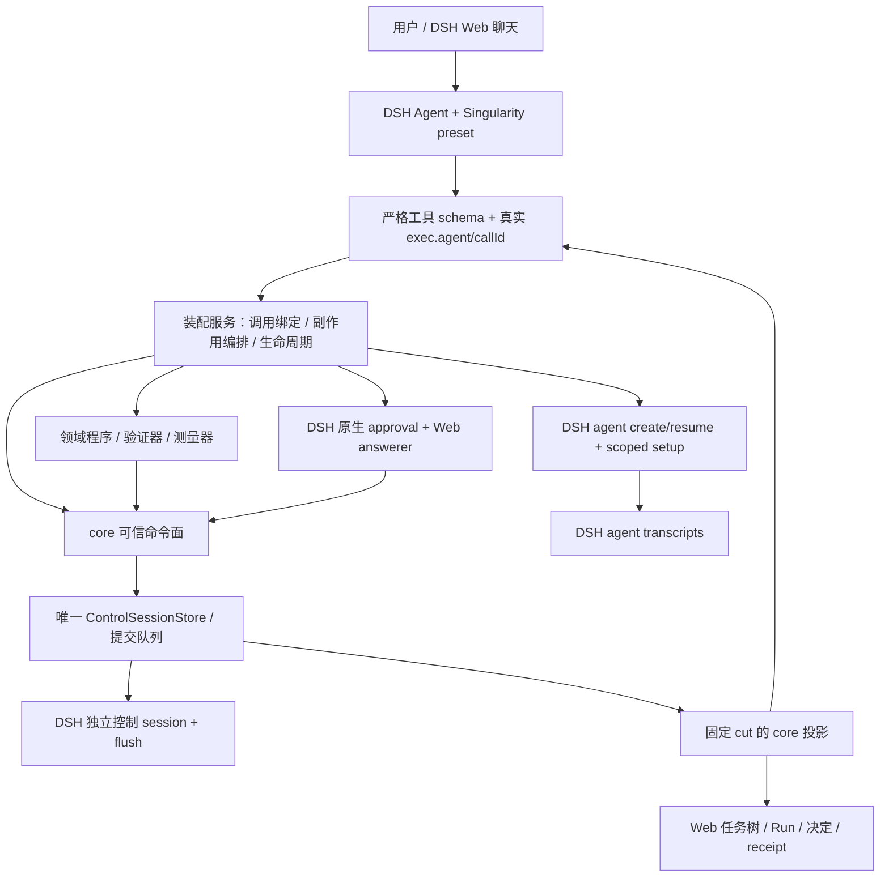

# 装配层蓝图与框架

日期：2026-10-10。基于 `singularity-core` `1a7dc126915bd4efa715ccbf250d54bc1e0ea583`。这是后续构建合同与建议框架，**尚未实现装配包或修改 profile**。先处理 [装配前审核](assembly-review.md) A01—A06；原 [blueprint](blueprint.md) 继续是总入口。

## 1. 目标与边界

让现有 core 成为真实 DSH Web agent 的任务基建：用户选择 Singularity preset，在普通聊天中提出领域目标；agent 经工具提出契约/分解并执行，装配服务调度必要的会话和副作用，独立验证后给出同一投影与凭证。方法改进通过真实评估、已提交选择与原生人审进入下一次 Run。

第一交付沿用 DSH 线性聊天、工具结果与审批 UI，先形成可运行单任务产品。任务树面板随后接同一读投影。完整画布、group/router 与任意多图管理在存在真实消费者时另定契约。



| 所有者 | 所有的事实或行为 |
|---|---|
| DSH | Agent/Session 生命周期、transcript、模型/工具执行、持久化后端、原生审批与 Web 聊天 |
| core | 契约、Task/Run/责任、冻结实验、决定、版本、拒绝与提交不变量；同一事实的一次权威解释 |
| 装配包 | 真实 caller 绑定；准备工作区/输入/实现；驱动 create/resume、执行、drain、验证、消费记录、发布与恢复；持有其创建对象的 disposer |
| 领域配置/实现 | 目标模板、判据、受保护输入、指标/单位/方向、能力资产与执行装置 |
| Web client | 展示提交后的投影；用户输入、原生审批、局部窗口/视口状态 |

装配层不维护第二份 Task/Run/pointer 状态。进程内 handle、在途操作与缓存有各自用途，不能成为持久化权威。副作用需要恢复信息时，记录必要的领域事实与 DSH 来源引用。

## 2. 旧仓应复用的接线方式

| 旧仓位置 | 采用的行为 | 新框架的归属 |
|---|---|---|
| [shared.sessionId](../../bb_work/harness/packages/singularity/agent-singularity/src/shared.ts:13) | caller 来自 `exec.agent`，不由参数填写 | `binding.ts` |
| [工具定义与注册](../../bb_work/harness/packages/singularity/agent-singularity/src/tools/task-submit-result.ts:8) | `defineTool` 严格参数、`ctx.tools.register`；调用服务 | `tools.ts`；保留结构化错误，不吞为成功字符串 |
| [rootSetup](../../bb_work/harness/packages/singularity/agent-runtime/src/index.ts:584) | factory 的 unpublished setup 中挂 preset、prompt、restriction；create/resume 共用 | `setup.ts` + 当前 runtime 接口的小幅扩展 |
| [submit/drain](../../bb_work/harness/packages/singularity/task-runtime/src/service/drivers.ts:289) | 显式交付先关准入，drain 后才验收 | `task-driver.ts`；事实与合法转换进入 core |
| [child driver](../../bb_work/harness/packages/singularity/task-runtime/src/orchestration/child.ts:1) | 仅 verified 解锁依赖，失败不冒充完成，同会话恢复 | `task-driver.ts` 的显式子任务调度 |
| [bundle manifest](../../bb_work/harness/packages/singularity/bundle/package.json:29) | `dsh.bundle.patch` 声明普通 Cordis 行，profile 堆叠 bundle | 新装配包 manifest + patch |
| [Web view route](../../bb_work/harness/packages/singularity/graph-web/src/web/api/view.ts:89) | 工具/UI 从共同读源拿快照；失败具名 | `view.ts` + `web.ts` |
| [client manifest](../../bb_work/harness/packages/singularity/canvas-view/package.json:29) | 独立 client 入口、host/client 注入分开、贡献有 disposer | 装配包 `./client` 入口，G2 才启用 |

不迁移旧 v4/v5 evolution ledger、pointer intent、兼容读取、协调者专有账本或旧包划分。`model-smoke` 的手工插件树用于探针；产品从 DSH profile 启动，不把它复制成新的 Node 应用入口。

## 3. 最小包框架

保留 core 现有 `src/`。增加一个有真实消费者的装配包，先不用重排整个仓库：

```text
singularity-core/
  src/                         现有领域协议、命令和投影
  assembly/
    package.json               @dangosys/dsh-singularity-next；host/client exports
    cordis.patch.yml           host 装配行 + preset 声明
    src/
      index.ts                 Cordis plugin、严格 Config、生命周期
      binding.ts               exec.agent → 固定 control/agent/task/run 绑定
      setup.ts                 root/worker 的 preset、prompt、restriction、guard
      task-driver.ts           open/decompose/submit/fail、依赖调度与恢复
      method-driver.ts         G3：真实编辑核验、评估、选择、人审、发布
      tools.ts                 少量模型工具，只调用驱动服务
      view.ts                  一个 committed cut 的组合投影
      web.ts                   G2：Web 读接口与提交后的失效通知
      client.ts                G2：任务树/Run/receipt；复用原生聊天/审批
  deployment/
    singularity-next-web.package.json   目标 profile 的 manifest 模板
```

这是职责框架；先创建 G1 有消费者的文件，G2/G3 按阶段创建。不要提前写空服务、占位插件或 pass-through 模块。`task-driver.ts` 超出可审阅范围时按提交、调度等实际责任拆分。

core 与装配包输出可装载的 ESM JS 和 `.d.ts`。core 运行时 export 指向构建后的 `lib/index.js`；本地 `.ts` imports 由构建改写/打包，不能要求 Node 在 `node_modules` 内原生剥离 TS。当前 `tsc --noEmit` 保留作检查，新增真实构建路径。开发 peers 指向已核实 DSH checkout/宿主，运行时由 profile 提供；不使用探针 resolve hook、绝对 `/home/ROXY` alias 或移动的 latest 版本。

host 的 Config 明确声明 control、环境和领域部署所需值，未知键拒绝。首版一个 control 对应一个明确 Environment；agent 全局身份可由 control + 本地节点 ID 派生，或者使用 DSH 原生唯一 session ID。没有跨图共享消费者时不建全局方法库。

host 首先拥有一个装配 Service，在其异步初始化中打开 control store、创建可信命令面、显式恢复，再注册工具。按阶段声明实际使用的 `inject` 服务：G1 的 persistence/sessions/agents/agentLoop/tools/preset，G3 再核实原生 approval。scoped prompt、工具限制与权限在 Agent setup 中装配。关闭前先撤销工具准入，避免工具仍可调用已经关闭的 store。

## 4. 调用绑定与命令面

`forAgent` 是 core 内部原语；模型工具面使用装配服务的 `forCall(exec)`。以下是建议接口轮廓，不是已经存在的 API；字段应复用 core/DSH 类型，不重复抄载荷结构：

```ts
import type { Agent } from '@deepseek-ai/dsh-agent'
import type { ToolRunContext } from '@deepseek-ai/dsh-tools'
import type { TaskContract, TaskView, DecompositionChild, Refusal } from 'singularity-core'

type ChildProposal = {
  contract: TaskContract
  // 分解工具使用本批局部 key；driver 稳定生成真正的 taskId。
  key: string
  dependsOn: readonly string[]
  supports: DecompositionChild['supports']
  maxRuns: DecompositionChild['maxRuns']
}

interface Submission {
  summary: string
  artifactRefs: readonly string[] // 内容摘要由可信 driver 从实际字节计算
}

interface AgentTaskSurface {
  open(contract: TaskContract): Promise<TaskView>
  read(): TaskSnapshot
  decompose(children: readonly ChildProposal[]): Promise<TaskView>
  submit(result: Submission): Promise<TaskView>
  fail(reason: string): Promise<TaskView>
}

interface TaskSnapshot {
  controlId: string
  cutoff: number
  task: TaskView
  // G2 的 tree、run/receipt 来源继续引用 core 投影类型。
}

interface AssemblyService {
  forCall(exec: ToolRunContext): AgentTaskSurface
  attachRoot(agent: Agent): Promise<void> // 借用现有 Web 根 Agent，不取得第二个写句柄
  readForSession(sessionId: string): TaskSnapshot // 仅可信 host 消费者
  recover(): Promise<void> // 启动时显式恢复；GET/read 不触发
  close(): Promise<void>
}

type TaskToolAnswer =
  | { ok: true; view: TaskSnapshot }
  | { ok: false; refusal: Refusal }
```

`forCall` 检查 `exec.agent` 正是 registry 中的 live 对象；从其真实 session 与部署绑定解析 control、agent 和权限。agentless 调用拒绝，根与 child 的角色来自可信记录/preset。模型参数不能传 `actor`、`callerAgentId`、`sessionId`、`controlId`、任意 `revision`、`approvedBy`、verdict 或 measured quality。

commandId 用 `controlId + sessionId + exec.callId + operation/stage` 稳定派生；使用 DSH 实际分派的 call ID，PTC 子调用不能都退化成 root call ID。请求内容摘要单独检查。同一个调用重放产生相同任务/Run/子会话 ID；任务当前状态变化不使丢失答复变成新尝试。`signal` 贯穿准备、agent 创建和执行，取消不是验证 pass。

原语的业务检查仍在唯一 store 队列；外部执行/人审在队列外。调用者不可变作用域先确认；责任、head 等当前前提在“识别重复命令之后、首次提交之前”检查。不要因增加工具包装再建立一个事实提交队列。

## 5. 模型工具、preset 与执行阶段

| 工具 | 模型供应什么 | driver 决定什么 |
|---|---|---|
| `singularity_task_open` | 领域契约提案或受支持模板参数 | 实现/输入可用性，冻结验收，真实身份，Task/Run/Revision/Bubble，借用根会话 |
| `singularity_task_read` | 当前任务，无 caller 参数 | 一个固定 committed cut 的 Task/tree/Run/receipt 与缺失原因 |
| `singularity_task_decompose` | 子契约、批内 key、依赖、supports、预算 | 完整批次校验、稳定 ID、准入与会话责任，随后按 ready 调度 |
| `singularity_task_submit` | summary、交付产物引用 | 关写入、drain、实际字节身份、独立 verifier、结算与来源封存 |
| `singularity_task_fail` | 具名失败原因 | 停止对应工作、结算当前 Run、失败/预算传播 |
| G3 的方法工具 | 候选提案、读 round、请求审查 | 实际 diff 核验、真实评估、决定解析、原生 ask、条件发布；不给裸 approve/pointer 写入口 |

`startRun/openBubble/assign/reassign` 由 driver 使用，首版不直接一比一暴露为模型工具。这样 `forAgent → tools` 的含义是接入能力边界；工作区、模型、实现身份和责任并不由模型随意填写。

preset 是**每个 Agent 的工具/prompt 组合**；profile 是**整个 DSH 进程的服务组合**，二者不为每个 Task 各造一份。声明 `singularity-next` 根 preset 和一个实际使用的 worker preset；使用部署需要的现有 fs/shell/skill 插件，列出真实工具名与权限，不能假设 preset 名字自动授予权限。

根已有 Web 会话，首次绑定其准确 live Agent。自管 child 用 DSH `agents.create/resume`，在 `setup(agentCtx, agent)` 中挂 preset、工具限制、phase guard 和日志可重建的 system prompt；create/resume 共用同一函数。当前 `AgentSessionRequest` 按需扩展 `setup`、parent 和 session metadata；持有 handle 的 runtime 继续持有 disposer，不能让另一个辅助类接管同一 lease。

阶段纪律：

```text
未绑定（允许契约提案与只读）
→ working（允许被授予的任务工具）
→ waiting_children（父节点只读/协调，禁止冲突写）
→ working（孩子结案后继续父节点自己的职责）
→ submitted（拒绝新写与新分解，drain 排除当前 submit call）
→ 独立验证固定产物
→ verified / failed（只读；idle 本身不进入终态）
```

持久阶段来自 core 事实与 task tree；工具 guard 与恢复都读同一来源。需要提交记录时，在 Task 协议增加版本化事实，绑定 artifact、执行会话与来源截止范围；不在 driver 另写 `phase.json`。guard 覆盖被授予的 shell/fs/MCP 与后台任务，限制工具可见性还要限制实际执行。第一交付如果没有可确认的后台任务 drain，就不授予该能力。

Task 的验收由领域判据决定，LLM 不能选择一个恒 pass 的 verifier 或重写保护输入。候选模板改变方法，不改变父任务原验收。子任务 verified 才解锁依赖；父任务是否完成继续采用 core 的 Task/tree 判定，不新造“孩子都 idle 就完成”。

分解不把多个 `admit` 或 DSH `append([a,b])` 当崩溃原子事务。先完整校验批次与所有子契约；如用现有准入事实逐项准备，允许日志保留尚未发布的准备项，最后以单条完整 decomposition 发布批次，之后才派发。恢复按稳定批次身份继续或具名停止准备过程；不能把半准备项当可执行 child。要求真正跨实体原子准入时，应定义承载完整批次的领域事实，避免引入通用事务引擎。

## 6. 真实副作用、receipt 与恢复

在工作开始前解析完整 revision 内容、保护输入、实现字节与资源预算，再提交 Run/Bubble 引用。资产加载/工具真实调用从宿主记录 consumption；只有实际加载/使用的 Method 才记消费。bubble 中声明的模型/工具不能替代 transcript 的真实 request/header 与执行来源。

submit 先提交关闭准入，再确认在途工具及已授权后台工作停止，冻结产物和输入，再在队列外验证；验证事实与测量约束引用同一判决。控制终态固定各来源 session 的读截止范围、内容引用和完整性；receipt 从这些来源派生。常规 Web 读取默认返回该封存范围，追加聊天不会把“同一 Run 的正式 receipt”换成当前全日志 cutoff。

| 崩溃点 | 重开后的处理 |
|---|---|
| 准备 workspace 后、Run 提交前 | 未引用准备产物不生效；按稳定操作身份确认/清理 |
| child 创建后、领域绑定前 | 用稳定 session/operation 查证，完成合法绑定或释放孤立 handle；不再随机创建另一 child |
| assignment/Run 已提交、prompt 未送达 | 找回同一会话；由可识别的投递记录决定是否继续，不默认重发不可识别副作用 |
| submitted 后、验证未记录 | 保持写入关闭；恢复同一产物快照和验证操作，不重新允许 agent 改产物 |
| verdict/终态已提交、工具答复前 | 同一请求返回原结果；receipt 使用固定来源 |
| approval 已答复、控制事实未写 | 精确可关联才完成原请求；否则待重新批准，不能推断同意 |

这些操作没有跨系统 exactly-once 保证；可识别完成的操作按契约恢复，无法确定的外部结果明确呈现。插件 unload 停止准入、取消/排空工作，关闭其拥有的 child，再关闭控制 store；借用的 Web 根由 DSH owner 管理。所有注册、监听和路由通过 Cordis effect/disposer 归属。

## 7. G3：选择到发布的框架

显式 round 固定 incumbent、候选集合、历史 cutoff、测量口径与预算。候选提案需真实 diff/target 核验，reserved slot 按被核验的结构机制检查；不接受 proposer 自填“verified”。trial 单位由领域声明：重复执行确定性程序与独立模型求解是不同实验，报告不能混称独立模型 trials。

开放 round 可显示当前预览。关闭时固定 decision cut、候选 Evaluation 引用和 calibration；历史决定通过固定来源重算。累计 adopted edits 从真实选择/发布关联推导，A05 的 skill→tool 连续继承必须有产品路径反例。

建议受控发布依据：

```ts
interface PublicationBasis {
  roundId: string
  decisionDigest: string
  decisionCutoff: number
  evaluationRefs: readonly string[]
  // RevisionRef、报告/策略/校准身份从上述冻结来源核实。
  expectedHead: { revisionId: string; generation: number }
}
```

`draftFromDecision` 从 committed winner 生成 draft，不接受模型选择另一个 to；内容与 PublicationBasis 一起进入批准绑定。`requestPublish` 调原生 ask，向用户展示双侧差异、真实分数/成本、硬约束、噪声依据与 expected head。`approvedBy` 来自真实审批来源；宿主没有可验证的人身份时按来源如实记录，不伪造“实名批准”。

发布请求所在会话在 setup 固定要求人审的 approval policy，并接实际 Web answerer；测试自动允许、会话 auto-allow 和无人模式不能充当人的批准。不能仅凭字符串 `allowed-once` 断言屏幕上有人点击了允许，也不要在并发工具调用间临时切换整个会话的 policy。

发布重算原决定、核对目标内容、批准与 expected generation，调用唯一 pointer 切换命令。新 head 的独立 Run 必须真的加载该方法并记录消费。bootstrap/rollback 由明确授权的部署入口处理；不能给 worker 一个可绕过评估的裸 release API。

## 8. profile 进入 Web

建议先用独立 profile `singularity-next-web`，避免新旧 store、tools、preset 与 Web 入口同时被激活。目标 manifest 的形状沿用已核实 DSH 契约：

```json
{
  "name": "dsh-profile-singularity-next-web",
  "private": true,
  "dependencies": {
    "@dangosys/dsh-singularity-next": "link:/absolute/path/to/singularity-core/assembly"
  },
  "dsh": {
    "profile": {
      "bundles": [
        "@deepseek-ai/dsh-base",
        "@deepseek-ai/dsh-web-app",
        "@dangosys/dsh-singularity-next"
      ]
    }
  }
}
```

部署时将 link 替换为真实装配目录或安装包，不写入产品源码的路径常量。装配 manifest 使用 `dsh.bundle.patch` 指向其 patch 文件；client 启用时声明 `./client` export 和 `dsh.client` 的 web/inject 元数据。patch 插入装配 host 行与 `@deepseek-ai/dsh-agent-preset` 声明行，沿用 web-app 已提供的 preset registry，不重复挂 base/web 服务。

正确顺序是：真实构建 → profile resolver manifest → bundle patch → 宿主 `dsh --profile singularity-next-web --dump-config` 核对 → 同一 launcher 启动 → 浏览器选择 preset。dump-config 可能包含部署秘密，验收只保留脱敏的相关行。不得用另一份手写 `new Context()` 产品入口替代 profile smoke，也不依赖 registry 的 latest。

G1 借用原生聊天、工具卡片与 approval UI，直接验证工具消费；G2 增加一个读面板，返回 `formatVersion + controlId + cutoff` 和 core 的 Task/tree/Run/receipt 投影。agent/API/UI 对同一 cut 读取一致；不同时间的 cut 可以不同。SSE/通知只在提交后失效快照，重连重新读取，不在浏览器 fold 原始事实或乐观修改 Task 状态。

首版 UI 不修改图、责任或指针。会话打开/发消息与审批沿用原生服务；自管 child 使用正确 parent/session/descriptor 来源，不能把 child 当无来源的 root 暴露。自定义 host 读接口须接入实际 Web 访问域，校验请求能读哪个 control/session；不能假定 `webServer.register` 本身已完成这些权限。完整 canvas 延后，避免把旧 iframe/map 与旧协议一并带回。

## 9. 构建顺序与下次检查点

| 阶段 | 交付与退出条件 |
|---|---|
| G0：装配前修复 | A01/A02 的身份和批准重送反例变为拒绝/原结果；A04 generation 生效；A05 累计采用历史和 A06 冻结决定通过针对性反例。A03 的批准依据合同定好，G3 暴露发布前完成实现。持久变更版本化。 |
| **G1：单任务进 Web** | 可构建包与真实 profile；浏览器选 preset，agent 真调工具，实际执行并 submit，独立 pass/fail，固定来源 receipt，SIGKILL 后同会话恢复；无脚本代替工具关键步骤。**在此请求下一轮 review。** |
| G2：真实子任务与读面板 | 两个子任务存在依赖；唯 verified 解锁；预算/失败传播；父节点 waiting 期间写入被拒；准确 child 会话可读；工具与 UI 同 cut 一致；重连/重载/unload 不重复执行或漏 disposer。 |
| G3：RSI 产品闭环 | 同轮多候选共同 incumbent，至少两轮；真实编辑核验和冻结报告；累计历史接 proposer；真实 Web 用户批准唯一胜者；丢答复不重问；无胜者不动 head；新 Run 实际消费发布方法。 |

G1 的最小验收应包含真实浏览器工具调用、agentless/跨会话/跨 control 拒绝、提交后并发写入拒绝、实际 verifier pass/fail、失败/取消/持久化异常呈现、重开恢复和包构建产物装载。模型文字与输出方式可以变化，断言实际调用和事实关联。

交回材料：固定提交与宿主版本，脱敏 profile/preset/工具注册清单，一条真实任务的 command/Task/Run/session/Revision/产物/判决/receipt 来源，G0 反例修复结果，G1 浏览器记录与故障恢复结果，卸载后 lease/监听清理证据。G3 再提交真实用户批准、原始 trials、固定决定依据和发布后的消费证据。

先把一个用户任务从 Web 走到底；这一条通过后，装配才有可以复用的产品路径。
