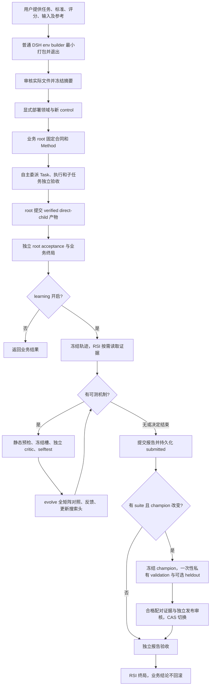

# RSI 启动、参考资料与 Buckyball 四模型任务

> 文档归档范围：历史记录。适用协议和证据仅限原文明确记录；未冻结的版本不推断。当前行为见[架构入口](architecture.md)，分类和来源见[文档目录](documentation-index.md)。

这是交付说明，供用户和环境准备者查阅，不附加到节点 system prompt，也不生成默认 Method/Skill。行为以当前代码为准；2026-10-23，Task v25，仅用于新图。

## 本轮修改与基线

最初按用户要求保存工作区的 checkpoint 是 `ddebbb3`，其中已有的实现不计为本轮新增。本次继续修复前 HEAD 是 `81784ca`；`4518d0c` 至 `81784ca` 的前半轮简化也属于同一次用户请求。比较完整修改用 `git diff ddebbb3..HEAD`，只看最后一轮则比较 `81784ca..HEAD`。

| 类别 | 实际修改 | 流程影响 |
|---|---|---|
| 归位并改写 | 四角色策略从 agent、preset、动态 review-purpose 等处合并到 `assembly/src/prompts.ts`；公共协议加角色职责 | 节点只收到一份核心角色策略，避免同一条规则在多个来源漂移 |
| 归位并删减 | 工具用途、枚举、参数、分页和绑定说明归 DSH `defineTool` schema；dispatch/outcome 只携带实例事实 | 不再把工具手册和后续行为提示反复拼进 system/通知 |
| 改内容 | root 以冻结标准为停止条件；已有可验收证据即可停止探索、提交 verified direct-child 的产物 | 仍须独立 root acceptance，但不要求每次成功后再创造更高目标或固定变体数 |
| 改运行投影 | live Session 统计已用/总量/剩余共享步骤，冷会话读 persistence；每步只送一行预算 | root、child、acceptance 共用同一计数，提醒为交付和验收保留空间；未加软截止或自动提交 |
| 删策略与协议字段 | 删除资产类别保留槽、停滞强制删资产，以及 `untried/prune/editBudget` | 无须为了探索配额增加 helper/Skill/Tool；仍最多六槽，每批 1–3 个单机制候选，冻结后失败扣槽 |
| 按需归位 | authoring 模板和规则同页；Method 资产、详细反馈、原始轨迹分别分页 | 默认 search 只返回状态、简要反馈和入口，不自动展开长材料 |
| 改默认产物 | builder 只整理用户提供的任务、验收、固定评分和试分工具；不用的 domain 字段可省略，host 给空 Method seed | 不再默认写 Skill、TaskTemplate、独立 Task、方法、审核手册、求解器或启动/验证脚手架 |
| 改内容与证据边界 | 报告引用 `roundId` 和机制观察，宿主向 reviewer 提供冻结分数/成本 | 不再要求作者重复抄算数字；自行写出的数值断言仍须准确 |
| 修实现 | execution profile 从真实宿主的 mounted preset/Loader/base URL 解析并 hash 插件，包含各 preset 的实际来源 | 动态加载的原生插件不会因 assembly peer resolution 不可见而误记缺失；真实缺失仍拒绝迁移资格 |
| 修生命周期 | 先持久化 `run/submitted`，再执行私有 validation/heldout、发布审核和报告验收；恢复复用同一入口 | 私有结果产生时作者已经失去写入和提案资格；写盘中断后接着同一次试验，不能靠重交报告重抽 |
| 关闭发布捷径 | 无 suite 可以执行业务与局部测量，但不得发布；发布必须重算冻结独立 validation 的配对证据 | 单题 winner 不再直接改变生产 Method；合法负发布审核只拒绝发布，不强迫作者重写报告 |

memory 的主要按需机制在 checkpoint 已存在，本轮明确其架构说明、按需界面与验证，不能把它全算作本轮新实现。`singularity_memory()` 首次显式调用准备一次有界父背景；`ref` 读已有 notes，不自动塞入子 prompt。notes 不能提升为验收事实，RSI notes 不进入普通业务。DSH BasicCompaction 仍负责本会话压缩；本轮没有另建 memory store，也没有改变其 70% 窗口阈值。

## 当前完整流程

1. builder 是一个普通原生 headless session，不是 Singularity Task/RSI。它检查最小有效/无效评分样例，产出 manifest 后结束；不搜索任务答案、不自行批准或启动实验。
2. 部署显式选领域。业务根固定合同、输入、方法与预算。root 负责协调；子 Task 可原子执行，也可继续分解。产物通过封存附件和 declared inputs 交接，没有共享可写源码树。参考仓库只读，修改放在工作区或 patch 中，由用户合同确定交付形式。
3. 子任务提交后独立验收。root 证据足够时停止多余探索，提交一个 verified direct-child 的封存产物；需要合并时才委派集成。根再独立验收，成功/失败均先形成业务结果。
4. learning 开启时，业务终局后封存原生证据，另起 RSI 作者。它可修改可复用 workflowGuidance、TaskTemplate、Skill、Tool；不改变本次冻结业务合同、验收或评分。无收益、证据不足均是正常结束选择，不必用完六槽。
5. 候选先过纯静态整批预检，再冻结槽。独立 critic 只判断机制是否支持安全测试，不能提前索要尚未产生的收益；通过后 selftest，再跑原生业务 root 到 acceptance 的 evolve 比较。相同口径的完整 incumbent 观察可复用，保留来源。
6. 作者在无 pending 工作时提交报告。提交先封存并持久化，之后才开始私有验证；作者不能读取私有结果继续改 champion。同一 tranche 消费一次，恢复沿用冻结身份、TrialKey 和已有测量，不重抽、不复活作者。
7. 发布要求 suite、冻结独立 validation 的合格配对证据、完整成本/硬门信息、独立发布审核和 CAS。heldout 可选；有配置就跑并提供给 reviewer，当前代码没有额外要求 heldout 自动为 improved 的硬门。负发布审核保留生产头；报告本身可诚实通过。发布后新业务固定新方法，已运行任务继续原版本。
8. 报告独立验收后结束 RSI；报告不准确可导致 RSI failed，而已验收业务结果保留。取消或原生失败关闭所属工作及后代，取消后不得发布。

**尚存的产品边界：** `experiment run` 当前只启动第一个 evolve case 的业务 root。有效候选进入测量后才跑 evolve 的全矩阵，报告封存后才跑私有矩阵；它不会在零候选时自动把所有 case 做完一轮 pilot。满配 suite 不代表 CLI 已实现完整逐题 pilot，也不保证 RSI 一定找到改进。

## 满配启动所需输入

用户不需要先写 Skill、TaskTemplate 或求解步骤，但要提供有内容的任务集合，不能只给模型名。builder 可以格式化、计算摘要、实现已定义的评分规则，不能替用户发明任务、独立性或关键验收目标。

| 输入 | 用户需要确定的内容 |
|---|---|
| 任务 | 每个 case 的目标、可修改范围、固定输入、最终 artifact、明确结束条件；同领域独立任务集合由用户提供 |
| 验收 | 正确性、容差、硬性资源/功能约束；哪些是硬门，哪些是可折中评分；允许负面结论的调查应明确 |
| 评分 | 指标、单位、方向、权重/公式、固定基线、失败/缺测策略；不能 goal 要求面积延迟都降，scorer 却允许无限面积换延迟 |
| 对照划分 | case/family/source 的来源与独立性依据、evolve/validation/heldout 分组、每 case trial 数、权重；私有答案与测评不进入公开参考 |
| 物料 | 仓库与 commit、checkpoint/输入/参考输出及摘要、编译器和模拟器版本、工具实际路径、可用资源和限制 |
| 参考资料 | 指定哪些资料可供探索；只有用户明确要求的流程/交付约束才转成 contract criteria |
| 试分工具 | 已有命令或公开调用规范；没有现成工具时 builder 可实现必要 scorer/measurement，不默认写求解器 |

最小环境文件通常是 `setup-manifest.json`、`domain/task.json`、`domain/suite.json`、必要输入、公开 scorer；数值优化再加 measurement adapter。`task.json` 是领域声明，不是默认生成的独立 root Task。无模板时 host 创建空 Method：`workflowGuidance: ""` 与空 templates/skills/tools。独立 Task JSON 只在用户明确请求时额外保存。

宿主另需已安装的私有 DSH、新 controlId/workspace、显式 domain 路径、现有模型路由与凭据、bubblewrap 和依赖可达性。凭据不进入包。开启 learning，`evaluationParallelism: 1`，提交后用 `--wait-learning` 等 RSI 终局；不必设置 methodFile。评测并行度只限制 trial，不是全局所有后代会话的六并发硬闸；当前没有新增 provider 限流器，部署应核对既有路由的全局限流，并避免同时开多个 campaign。

## Buckyball 与四个模型如何定义任务

Buckyball 是共同硬件平台；模型任务是 **CosyVoice3 0.5B、Qwen2.5-0.5B、SmolLM2-360M、Spark-TTS-0.5B 四项**，不能把 Buckyball 再算成第五个独立 family。下表是需要用户补齐的定义，不代表 builder 已确认模型结构或生成了任务。

| 对象 | 必需资料与范围选择 |
|---|---|
| Buckyball 公共平台 | 精确 repo/commit/submodules、可改 chip/ball/compiler/runtime 边界；核数、SharedMem 容量/带宽、shape/dtype/layout、ISA/ABI 与内存模型；现有 examples/注册与构建命令；最终交付源码/patch、配置及可复现证据 |
| CosyVoice3 0.5B | 精确模型仓库与权重 revision、实际 config、完整推理图；究竟只覆盖语言模型核心，还是包含 frontend、flow、vocoder；token/audio 输入、speaker/conditioning、采样/流式配置、golden tensor/audio；正确性容差、质量下降上限和性能边界 |
| Qwen2.5-0.5B | Base/Instruct 的明确版本、tokenizer/chat template、权重、prefill/decode 工作负载、batch/上下文/输出长度、KV cache、精度/量化许可；参考 logits/token 或任务质量标准 |
| SmolLM2-360M | 精确版本与权重、tokenizer、模型 config、同等明确的 prefill/decode 边界和参考；不能直接假定与 Qwen 的算子、维度或数值行为相同 |
| Spark-TTS-0.5B | 精确模型/权重、文本与 speaker/audio conditioning、tokenizer/codec、生成主干与音频解码的覆盖边界、随机种子/采样参数、golden 输出与质量标准 |

“0.5B”不能决定 scope、shape、量化或评分。TTS 生成含随机性，最终音频逐字节一致通常不是可直接假定的验收条件；应由用户选择固定模式下中间 tensor 容差、音频质量和端到端目标。共享 Qwen 核心、tokenizer、训练来源或同类算子瓶颈都可能造成 family 依赖，需用实际 config/源码说明，不能只看模型名称宣称独立。

每个任务还需共同指定：

- **目标平台与性能口径。** FPGA 需板卡、器件、时钟/内存、bitstream/驱动、实际执行权限；ASIC 需工艺库/PDK、时序/IO 约束、SRAM 宏、工艺角、综合/布局布线工具和许可。若只具备 Yosys/OpenSTA，明确是综合/STA 代理指标，不能声称最终物理 PPA。
- **输入与基线。** 固定 workload 与模型输入分布，cold/warm 状态、batch、prefill/decode、音频时长/采样率；每 case 的正确性、性能和资源 baseline 同工具同条件获得，提供原始记录。没有统一基线的数值不要临时拼成跨模型总分。
- **评分。** 用户选择延迟、吞吐、能耗、面积/资源、带宽等目标及折中；固定归一化和 hard guards。返回原始 metrics 与单位，不能只给一个神秘总分。Agent workflow token 成本与硬件延迟/周期是两类成本，不能混用；模拟器墙钟不是芯片周期。
- **可交付验证。** 新算子或相关改动做定向小 RTL/BallOp 测试；软件/模型链可用 reference、BEMU/fullmodelBEMU 和必要编译对齐。**不跑全芯片 Verilator**。若合同要求 FPGA P2E 或物理实现，仍须有对应设备/工具与实测证据；没有它们就缩小合同，不能把 BEMU 等同于 FPGA 全模型验收。
- **运行条件。** 工具绝对路径、版本/构建摘要、CPU/RAM/磁盘、每次构建/测试 timeout、设备互斥、必要离线缓存和模型权重访问。已经找到命令不等于确认许可、板卡可用或测量已通过。

这些是“做什么、怎么判定”的物料，不是预先强制的一套求解算法。Singularity 根据任务选择探索、设计、编译与验证顺序；用户明确要求的关键设计门才固定进验收。

## 四个模型与当前统计门槛

当前 [paired.ts](../src/measure/paired.ts) 要求每个被比较 split **至少三个独立 family，每 case 至少两次 trial**；[suite.ts](../src/measure/suite.ts) 禁止同一 family/source 跨 split。trial 重复、batch 大小、输入长度和随机种子不增加独立 family。

| 配置 | 能做什么 | 不能据此声称什么 |
|---|---|---|
| 仅这四项，按实际来源分组 | 可以准备并运行业务/RSI 冒烟，观察未发布的候选与个别未见模型表现 | 不满足三个 split 都有 ≥3 独立 family 的满配配对证据 |
| 1 个 evolve family + 3 个真正独立 validation family，各 ≥2 trials | 代码允许的较小发布配置，不设 heldout；仍须各门和 reviewer 通过 | evolve 的 paired 统计仍不足，没有独立 final heldout；四个模型也未必能证明四族独立 |
| evolve/validation 各 ≥3 真正独立 family，每 case ≥2 trials | 两个 split 的完整配对比较；最低六族 | 没有 heldout 不能称最终未触碰集合验证 |
| 三个 split 各 ≥3 真正独立 family，每 case ≥2 trials | 当前代码支持的统计覆盖完整配置；最低九族，建议更多 | 最小样本不保证检验效力、收益或广泛泛化，服务端模型 revision 仍 opaque |

因此，若严格只提供这四个模型并把每个模型视为一族，**不能凑出九个不跨 split 的独立族**。用户可以选择先做四模型可行性/定向迁移实验，明确不作满配统计结论；要按现有门槛满配，需要继续提供真实独立任务族及来源依据。builder 不通过改名、拆重复输入或自行写新任务补齐，也不修改统计门槛让数据“过关”。

最小九族、每族一个 case、每 case 两次 trial、一个候选的完整 baseline/candidate 三 split 比较，需要 **36 个业务 trial**，每个 trial 还含子任务和独立验收；不含最初业务、RSI 作者、critic、发布审核和报告验收。后续候选可复用同口径 evolve baseline，私有集只在最终封存后使用一次。评测并行度保持 1。

## 用户提供的两套 .agents 在哪里进入

来源：

- `/home/ROXY/code/bb_work/env/BB/buckyball/.agents`
- `/home/ROXY/2026-10-14_gpt-6/.agents`

两套资料中 chip-designer 的拓扑/内存配置、model-port 的模型准备与 fullmodelBEMU/P2E、model-optimize 的量化/layout/bank/schedule、workload-tests 的测试分层、ball-align 的 C/BEMU/MLIR/小 RTL 对齐、check 的注册检查、debug-performance 的 FPGA 周期证据可以作为技术参考。它们的具体路径和命令必须与所冻结的 Buckyball commit 核对。

进入顺序为 **用户请求 → builder 选择相关技术资料并注明来源 → 只读公开参考或 case 输入 → Task 按需读取 → RSI 分析实际消费效果**。无需默认把文件转换为 Method Skill。后续 RSI 若有证据需要，才自行提出并测试可复用 Skill/Tool。

角色身份、UI 协作、人工审批、自动派生 Agent 的规则不因文件在 `.agents` 中而生效。`graph-contract/agent-runtime` 等旧 router/group 架构也不覆盖当前 Task 内核。model-port 资料中的“完整 port 需 P2E”是一种具体验收范围：用户若选该范围，就要提供对应设备；用户只选 BEMU/代理 PPA 时，应明确交付范围，不悄悄声称满足原完整 port。

公共源码和技术资料可以共享，但公开参考不要覆盖整个环境目录或包含私有 suite、golden 答案、历史候选。大权重、外部 repo 与工具链用精确路径/revision/摘要和权限声明；`setup-manifest` 不会递归冻结清单之外的外部目录，启动前应核对。与某 case 绑定的公开输入按该 case 装载，私有测评材料仅交给宿主/独立检查使用。

## 本次验证能证明到哪里

前轮真实 builder、业务收尾和单候选 RSI 的原生日志见 [简化审查](prompt-simplification-20261023.md)。builder `232ec46` 产物为 7 文件、8818B；业务 31 原生步、mem 0、主动提交并通过根验收。那个 RSI 因 execution-profile 缺失未跑私有集，最终报告数字失实导致 RSI failed，候选未发布；单样本成本差不能归因于方法。

v25 的 Loader、提交边界、负发布审核、冷恢复、取消和报告格式修复通过构建、93 文件/1037 项测试、8 gates 与真实 native preset 挂载验证；没有重新跑远程模型或芯片实验。尚未核验这四个模型的全部权重/输入、ASIC 许可或 FPGA 设备，没有进行全芯片 Verilator，也没有宣称已证明芯片迁移收益。
