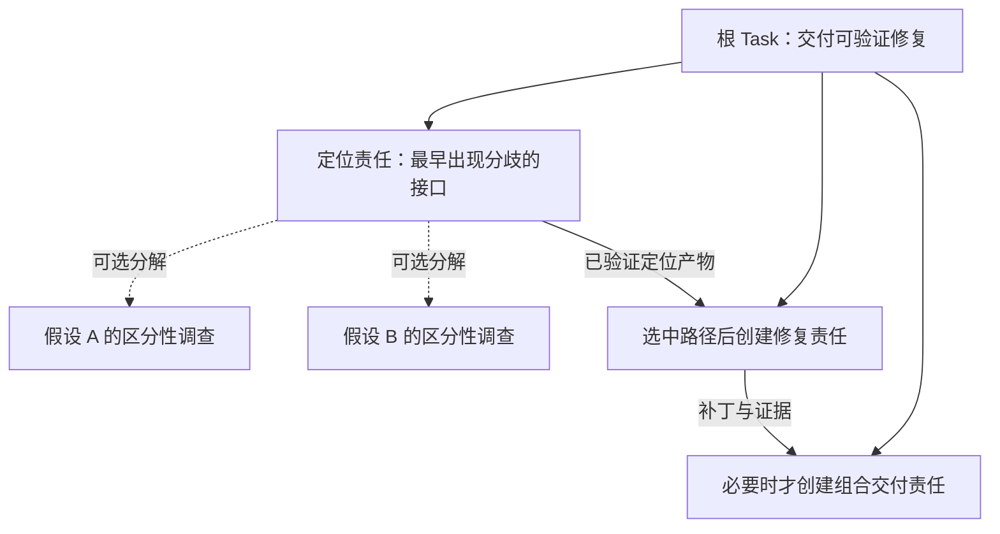

# Task 为一等公民的 Workflow RSI：终局实施计划

审查日期：2026-10-17（Asia/Shanghai）。代码基线：`4314487`。
RRSI 对照：本机 `../rrsi`，commit `be50316e1db05914068a973f322770ef08ed7ba1`。
实施更新：2026-10-19。**Task/Workflow、多任务矩阵、有界稀疏搜索和独立迁移发布已有工程链路；Buckyball 最小 C/ISA pilot 的业务根已通过独立验收。最新 CommandCode 运行的六个提案槽全部在结构检查中 invalid，零 round、零候选比较、零迁移或新方法发布；完整 pilot 的逐题执行入口仍未接通。本轮将纯静态预检移到批次冻结前，并补齐错误定位与提交要求。** 当前为 Task v23 / Strategy v9 / Measure v5 / Review v5 / snapshot v13，只接纳新图，不提供旧图兼容。预检通过后批次冻结 1–3 个候选、每候选一个独立机制、总计最多 6 个槽、repair=0；这是 KISS 稀疏模式，不宣称实现退火。原生 DSH 继续拥有会话、重试、用量和持久化。准确实现、验证与外部阻断见第 9 节。

本版按用户最新定义收敛：Task 是 workflow 中可独立交付、验收和追责的节点；RSI 演化节点定义、分解和关系组织策略，Skill/Tool 提供配套能力。评测负责验证这种演化，而不替代产品主体。第 1、6 节给出最终对象模型和执行语义，第 9 节给出唯一施工顺序，第 13–16 节给出研究、Buckyball 和提示词的验收细则。不再另写一份相互竞争的 final-plan。

本计划接替旧装配蓝图的施工排序，保留旧文档中的历史证据。遇到历史设计与本计划冲突，先按本计划列出的新行为修改测试与实现，不为旧行为建立兼容桥。具体执行仍以用户最新指令为准。

## 1. 结论与产品目标

**Task 是 workflow 的一等公民节点：具有完整责任契约、输入输出边界、独立验收、执行状态和来源关系。** 根目标也是 Task，组合节点和叶子也是 Task；TaskCase 只是评测时构造根 Task 的数据，不是 Task 的定义。Run 是节点的一次执行，Agent 是承担执行的会话，三者不能混用。

**Workflow 是这些节点及其责任、依赖、贡献和证据关系构成的动态执行结构。** 可复用的方法规定如何生成和调整这种结构；一次执行中实际形成的图是方法作用于当前目标、输入与观察的结果。RSI 应当演化这种组织方法及其配套 Skill/Tool，使未来未知任务能得到更有效的 workflow。

原架构对此已有清楚的基础：冻结契约、增量分解、单父责任树、依赖 DAG、`supports`、准确 Run/产物来源、父子问答、独立 ReviewRun、提交屏障、方法固定和单一控制日志。保留这些基础。本轮接通了 **workflow 策略送达、全局方向与局部责任、协调与执行分权、整图预算和多任务 RRSI 选择闭环**；模型实际遵循策略、行为因果归因和真实领域效果仍待实验。

在这个条件下，写更多“请泛化”的提示词不能解决选择偏差。系统可以越来越擅长当前输入、当前验收口径和当前评审习惯，却没有证据说明它在整个领域更可靠。独立审核可以排除明显泄漏，不能替代陌生任务上的观测。

目标应改为：

> 用户提交根 Task；agent 在冻结契约下生成并执行由 Task 节点构成的 workflow。每个节点知道全局目的、自己的贡献和上下游接口，并在有限责任范围内自主探索。轨迹反过来改进节点定义、分解粒度、关系、上下文使用、Skill 与 Tool；改进经有界 RRSI 和独立任务验证后发布。没有可靠改进时正常结束。

这里的“更聪明”指**固定模型在领域环境中的系统能力提高**，包括更好的问题分解、证据获取、工具使用、错误定位、停止判断和新任务成功率。当前实现不训练模型权重，不能把 harness 改进写成基础模型参数能力提升。RRSI 是降低过拟合风险的方法，不是泛化保证。

### 1.1 完成标准必须分开

| 层次 | 可以据此宣布什么 | 不能据此宣布什么 |
|---|---|---|
| 工程回归通过 | 协议、构建及已覆盖行为可用 | 领域任务一定成功 |
| 单 Task 独立验收通过 | 这次交付满足冻结契约 | 方法具备迁移能力 |
| evolve 集改善 | 候选在已用于搜索的任务分布上改善 | 未见任务改善 |
| 冻结方法通过未见任务评估 | 在已声明的任务分布和样本范围内存在迁移证据 | 所有任务、所有模型均改善 |
| 有界搜索结束且无赢家 | 按实际比较覆盖报告无改善或证据不足，原方法继续工作 | 已完成有效比较、必然失败或必须继续搜到赢 |

### 1.2 终局决策：实施时不再重新发散

| 决策 | 本版确定的选择 |
|---|---|
| 一等对象 | Task；workflow 是同一批 Task 事实的关系投影，不建第二份 workflow 状态库 |
| 图结构 | 单父责任树 + 依赖/产物 DAG + criterion 支持关系；不以一条无类型连线表示全部语义 |
| 方法载体 | 复用 MethodRevision；新增一个短 `workflowGuidance` 字段，配合现有 template/skill/tool，见 6.5 |
| 自适应层次 | 单次执行增量建图、选分支、复用证据、有限重试；跨方法版本改变粒度、模板和关系策略 |
| 修改边界 | 已接纳 Task 契约和已固定 Run 输入不可回写；不提供任意重连运行节点或删除失败历史的图编辑器 |
| 全局视野 | 宿主提供同一根任务内的目标/关系概览与按需索引；完整正文按责任和证据权限读取 |
| 局部自主 | 节点只对自身冻结交付负责，可以自行调查、执行或继续分解；父规定接口与验收，不规定全部步骤 |
| 协调响应 | 子节点重要事实到达即通知准确父 Run；协调/规划与执行/提交分别判权限，未满足依赖仍不能提交 |
| 根与审核 | 部署 root 保持协调角色；独立审核保持独立，不参与候选自证 |
| 学习信号 | 根交付效果 + workflow 机制观测；节点数量、树深和 token 降低不能单独买到发布 |
| 技术规模 | 一个 Task 内核、DSH 执行底座、control log、方法发布指针；不加 workflow DSL、全局聊天黑板或新的调度服务 |
| 完成定义 | 第 12 节的工程出口全部有证据；领域改善另行给出通过/不通过/证据不足 |

原始 KISS 文档说“Task 是契约，不是步骤”，这里保留的是节点责任独立、标准不漂移和流程由依赖产生的内核。用户所说的 workflow 指这种节点组织结构，完全可以作为自改进对象；不将旧文档对固定 SEQUENCE 的反对解释为禁止 workflow 演化。原文中的 token 闸门等历史提议仍以用户后来的明确约束为准。

## 2. 本次实际审查范围与验证

### 2.1 范围

审查从完整当前树出发，启动时工作树干净，没有只看未提交 diff。重点逐段阅读了以下生产路径，并对其余源码、测试入口、配置和文档作交叉检索：

| 范围 | 主要读取入口 | 目的 |
|---|---|---|
| core | `src/task/{protocol,contract,lifecycle,tree,responsibility}.ts`，control store，strategy/measure/release | 契约、运行状态、冻结比较、发布、事实所有权 |
| assembly 执行 | `surfaces.ts`、`inputs.ts`、`attempt.ts`、`submission.ts`、`scheduler.ts`、`driver.ts`、`review.ts` | 从目标到子任务、产物、独立审核及收尾的真实接线 |
| RSI | `improvement.ts`、`rsi-proposal.ts`、`rsi-policy.ts`、`evolution.ts`、`native-solve.ts`、`method-release.ts` | 证据、候选、评估、拒绝、结束和发布 |
| 方法与隔离 | `method.ts`、`method-run.ts`、`domain.ts`、`domain-measurement.ts`、`bubble.ts`、`workspace.ts`、`coordination.ts` | 资产可变边界、能力绑定、输入保护、读权限 |
| 运行与使用 | provider、memory/read、Web 和 FocusPanel、campaign/build/deploy/gates 脚本 | 重试、定位、重复运行、安装、可解释性 |
| 领域 | letters、PolyBench/C 3mm、SHA256 的声明、基准入口和授权文本 | “领域”是否实际只表示一个任务 |
| Python RRSI | `loop.py`、`history.py`、`schedule.py`、`selection.py`、`evaluate.py`、`calibrate.py`、`propose.py`、`critic.py`，analyst/digester 的证据管线 | 对照真实约束，而非照抄二手描述 |
| 项目规范 | README、blueprint、context、spec-policy、ADR0001、RRSI 对照文档、KISS 原始设计 | 识别历史约束、失效入口和设计漂移 |
| Workflow 终局复核 | `task/{decomposition,tree,commands,responsibility}.ts`、`surfaces.ts`、`coordination.ts`、`read.ts`、`scheduler.ts`、`template.ts`、`method-run.ts` | 逐节点响应、可见范围、增量关系、策略实际消费和修改边界 |

审查不等于形式化证明。后文明确区分直接可见的实现问题、架构缺口，以及仍需行为实验确认的风险。

### 2.2 已运行的验证

**2026-10-19 最新实跑与提交边界复核：** 只读检查 `/home/ROXY/singularity-next/buckyball-commandcode-rsi-20261018-214154`，committed snapshot cutoff 80。业务根 `task-039780304071e184` 已验收，RSI `improve-7efa57d998fb8b97d8d7a236` 报告已验收、状态 completed，搜索结果为 insufficient-evidence。六个单槽批次全部 invalid：第 1–3 次 evidence 缺少必需的 `eventSeq`，第 4、6 次在 failure/gap/habit 三类之间重复使用同一 label，第 5 次只提供 `workflowGuidance`、缺少完整 Method 集合，实际 diff 因而包含基线模板删除，超出声明的 workflow 改动。第 5 次 workflow target 本身正确；现有事实不支持报告中将失败归因于 `rootId` 或 workflow target 宿主错误的说法。没有 proposal/publication critic、没有 measure/strategy 测评事实、没有 round 或 transfer。运行中一次原生重试恢复，六次失败的直接原因是提案结构，不能归为 provider 耗尽或 family 统计门。

本轮边界调整：新批次对一次读取的同一份 bytes 做 JSON、proposal schema、完整 Method、实际 diff 和冻结 evolve case/family ID 的纯静态预检；任一文件失败则整批不冻结、不扣槽，返回文件与字段位置。全部通过后才保存并冻结这些 bytes。已有 pending 批次直接从附件恢复，不重新读取工作区草稿。冻结后的证据有效性、reserved/prune、critic、duplicate 与 smoke 失败仍各自结算并扣槽，repair=0；静态预检不读取证据正文、不调用模型、不执行候选或测评，也不建立新工具或第二套状态。本轮 `pnpm verify` 退出 0：**90 文件 / 945 测试 / 7 门禁通过**，包含构建、类型检查和源码/产物摘要校验；日志 `/tmp/singularity-rsi-admission-verify.log`。最后调整嵌套字段与 diff 的解析顺序后已重新构建，相关 2 文件 / 46 项定向回归通过，日志 `/tmp/singularity-rsi-admission-followup.log`。尚未部署或用真实模型重跑，下面的历史数字保留其原有基线。

**随后完成 RSI 提示与 JSON 合同复核：** system prompt 保留工作流程与角色边界，完整字段规则和模板按需读取；无 ref 的 `kind=method` 提供当前搜索头的 `proposal.template` 与 `reportTemplate`，完整 Method 只返回一次；审核 dispatch 按实际 digest/criteria 生成合法 `unknown` 模板。已修正公开领域知识/答案泄漏的冲突表述、报告先封存再触发 suite 私有验证的时间边界，并将工具 `read.kind` 设为必填。直接填写运行时模板的提案使用真实原生事件引用后进入独立 critic；审核从模板生成的 findings 通过实际解析器。最新 `pnpm verify` **退出 0：90 文件 / 946 测试 / 7 门禁通过**，含构建/类型检查和源码/产物摘要校验；日志 `/tmp/singularity-rsi-prompt-verify.log`。三份文档 JSON 和本地链接通过检查。未部署或真实模型重跑，详见 [RSI agent 工作合同](rsi-agent-contract.md)。

完整 pilot 仍未完成：`runExperiment` 仅提交第一个 evolve case 的业务 root；有效候选请求 round 后，driver 才执行该 split 的完整 case×trial 比较，冻结 champion 后才可能进入 validation/heldout。suite 已冻结不会自行调度其余 pilot 业务案例。每 split 仅一族是后续独立统计限制，补完 pilot 也不足以满足最少三族的正式配对门槛。

**2026-10-18 较早 RSI 实跑故障与减量修复：** 运行目录 `/home/ROXY/singularity-next/buckyball-commandcode-20261018-172430`，只读 snapshot cutoff 131。业务根 `task-5fc54cd5510aba92` 已 accepted；RSI `improve-043d458189286ffefc4b48eb` 最终报告也已 accepted、根 RSI completed，但零提案、零评估。原生 seq208 错把 `proposal-1.json` 交给报告提交工具，driver 在检查合同路径前已写 control seq122 `rsi/search-ended insufficient-evidence`；seq209 才拒绝错误路径。之后 seq223/224、242/243 的合法提案被已结束搜索拒绝，却误报“先完成当前批次”。这不是仍在运行的锁等待，而是不可恢复的提前终结；不能把 completed 报告算作有效搜索或学习成功。

删除 `rsi/search-ended`、`rsi/proposal-started`、`rsi/proposal-settled` 及对应重复状态。Run 的 `working → submitted` 是唯一搜索关闭边界；报告先预检合同路径、文件与冻结输入、封存产物，再做迁移验证。错误路径、缺文件不会封死搜索或消耗 validation tranche。批次只保存冻结槽、候选附件和一次槽结果，保留 `batch-ended` 作为请求评估已提交的恢复屏障；工作区候选被改写/删除后仍能从附件恢复。Method 纯解析先于 prune，非法候选结算 invalid，避免冻结批次持续抛 TypeError。搜索结果从实际发布、轮次和测量覆盖投影，缺观测、未知成本与不足样本仍是 insufficient-evidence。

同类检查补齐首次轨迹封存/analysis 创建前的显式恢复、复用冻结默认步骤上限、原生 idle 无待办即失败、审核会话步骤出口；业务已验收后可以单独停止 RSI。取消或 analysis 终态失败会中止关联审核、评估、验证及后代，结清已启动轮次和已消费迁移；发布在审核后及现有串行提交屏障内检查 signal、所属 Run 和业务根 RSI，取消/失败事实先入队时不能切换指针。真实 JSONL 控制日志回归覆盖这个队列顺序。只有尚未终结的启动失败可显式恢复；取消与已失败的 analysis 不复活。未消费的冻结迁移保留原事实，不伪造消耗验证集。

本次只修改主仓，历史运行、冻结 checkout 和宿主保持原状；未启动新的付费模型或把旧图迁移到新协议。工程验证以本节本次最终记录为准，历史 provider/余额失败分别保留。

最终 `pnpm verify` **退出 0：90 文件 / 944 测试 / 7 门禁通过**，含 core、assembly、frontend 类型检查及源码/产物摘要校验；日志 `/tmp/singularity-rsi-state-final-verify.log`。`pnpm run doctor`、`git diff --check` 通过；本次 5 个更新 Markdown 入口的 49 个本地目标与代码围栏检查通过。已覆盖错误提交不变更事实/不消耗验证、冻结候选冷恢复、启动中断、取消与失败传播、步骤耗尽、prune 非法候选、缺测结果口径及发布提交区竞态。离线回归不代表真实模型已用新协议重新完成学习，也不穷举所有并发组合；早期异步等待不稳定仍保留为未定位历史问题。

**2026-10-18 原生 provider 收敛：** 核查两次 CommandCode 实跑：`buckyball-commandcode-20261018-172430` 的 `improve-6b933ad9fe5ab573cb9888b2` 第 58 步（attempt seq341、turn/end seq343），以及 `buckyball-commandcode-20261018-161342` 的 `task-6f22ab12bc8ede34` 第 151 步（seq811/813），都在部分输出后以原生 `TRANSPORT: terminated` 结束、retry=0。共用冻结 `provider.ts` SHA256 `79ac58388e2f549e00d6e50e69ea6c7f49c9b1d5b1d55eedf54a8d36e66bdb8b`；其中 partial-output veto 截断 `agent/request-error` waterfall，DSH 无机会恢复。同轮 `task-ecfc0ec325c5ade9` 第 2 步无部分内容的连接错误已产生原生 retry 并完成，确认原生重试配置有效。最新一轮业务根已 accepted，失败的是 RSI；较早轮后续另有 QUOTA 余额不足，不将其混作可重试断流。

按用户要求完整删除 `provider.ts`、provider 状态侧日志、整图停机与新图重启 API/UI；错误分类、partial attempt、重试预算/退避/取消与最终失败直接使用现有 DSH。删除先到的 `agent/error` → `DSH_AGENT_ERROR` 包装，Task 仅从持久化 `turn/end` 记录原生原因。snapshot 升为 v12，旧实跑快照只读。

本次 `pnpm verify` 退出 0：**88 文件 / 903 测试 / 7 门禁通过**，日志 `/tmp/singularity-native-provider-final-verify.log`。定向 40 项及真实宿主集成 5 项已先行通过，日志分别为 `/tmp/singularity-native-provider-targeted.log`、`/tmp/singularity-native-provider-host.log`。全量构建反例中的 TS2322 是预期诊断，按命令最终退出状态判断。

native partial reasoning/text 恢复、失败工具不执行、20 次耗尽、永久错误、取消与真实宿主接线构成回归验证；原生 DSH 安装物、部署重试阈值及历史实验均未改写。

**2026-10-18 用户唤起后的真实进度复核：** 从运行中宿主只读导出 committed snapshot（cutoff 247），保存到 `/home/ROXY/singularity-next/buckyball-pilot-20261018/progress-check-20261018.json`。首次业务根 `task-2d32b3cb8b21b08e` 为 `verified / accepted`，独立审核的 `behavior` 与 `isa-and-scope` 均为 pass：修复 DMA 输出 stride，冻结补丁只改变目标参数，RISC-V/BEMU 与独立 scalar 对照及 ISA 证据通过。业务结果未被后续学习失败覆盖。

学习 Task `improve-f024ffbcefd951aa25df5993` 提交了一个候选 `method-90d174346a5327fe5f3f9f3c`，独立 critic 的 6 项标准及 materialization gate 通过。evolve 基线矩阵计划 4 槽、有效完成 2 槽，其余因余额不足及其 required 子节点连带失败而缺失；候选矩阵有效完成 0/4，2 槽直接遇到 HTTP 402、2 槽缺少有效基线。候选有效测量缺失不能解释为 0% 成功率。学习 Task 与根的 RSI 状态均为 `failed`，无 transfer 事实；唯一 pointer/switched 是初始方法初始化，没有新方法发布。该次失败不是“无改善”的有效领域结论。

当前 checkout 的 `src`、`assembly/src`、`scripts` 共 119 个生产文件与实跑冻结 checkout 内容相同。本次重新执行 `pnpm verify` **退出 0，88 文件 / 911 测试 / 7 门禁通过**，含构建和两层类型检查；日志 `/tmp/singularity-progress-check-20261018-current.log`。`pnpm run doctor`、`git diff --check` 通过。较早异步等待失败的根因仍未定位，本次成功不将其关闭。本次未重启任务或调用模型。pilot 每个 split 仍仅一族，未达到冻结的最少三族统计门槛；即使补全该 pilot 也不能据此宣称迁移收益。当前实现仍在 `4314487` 的未提交工作树中。

**2026-10-18 Buckyball 收尾与实际启动：** 当时 `pnpm verify` **退出 0，88 文件 / 911 测试 / 7 门禁通过**，日志 `/tmp/singularity-buckyball-final-verify.log`。适配器的补丁错误、基线不符、保护路径和 oracle exit 4 分类定向 **17 项通过**；启动时修正 CLI 的原生 HTTP 303 token 交换及无参数 RPC 接线，随后 CLI 回归 **11 项通过**，日志 `/tmp/singularity-buckyball-native-cli-check.log`。下面保留的早期异步失败仍是真实历史记录；成功运行不构成其根因已经定位的证明。

Buckyball 采用独立、无 gitlink 的最小 C/ISA 投影，来源 commit `c3317d2f0739f829c93a86bee145acc191898e81`，冻结投影 commit `6daecf88c741d8c1a3b898b8e49f5fdd3a35672f`；真实 stdio MCP 完成配置、BEMU 构建和已知 workload smoke，作者脏树未动。6 个明确标注 synthetic 的案例覆盖 DMA/ReLU/Gemmini 三族；所有 good 经干净 RISC-V 编译、3 个 seed 的独立 host scalar 对照和真实 ISA itrace 后通过，6 个 bad 均失败；工具漂移为 unknown，错误 stride 假设被 oracle 驳回。两个 verifier 并发取消互不破坏，worker 无法读取 suite、known-pass 或私有 oracle。证据在 `/home/ROXY/singularity-next/buckyball-pilot-20261018/private-oracle/` 和该目录 `isolation-check.json`。

运行前冻结 `experiment-spec.json` 与 suite；真实宿主 doctor 全通过，启动时根 `task-2d32b3cb8b21b08e` 进入 running，模型路由为 `deepseek/deepseek-flash`，服务 `http://127.0.0.1:7340`。启动记录在运行目录 `launch.json`；后续业务及有界 RSI 结果见本节最新复核。每个 split 仅一族，不满足冻结的最少三族统计门，不能发布迁移收益结论。该投影不覆盖完整递归依赖、MLIR/RTL/PPA；广域 toy CTest 仍缺 AlexNet generated `conv.c`，不影响独立重编译的六题。oracle 级 refutation 不冒充模型调查 Task。

**2026-10-18 较早实现进度复核：** 读取当前生产接线、工作包状态及提交记录，并重新执行 `pnpm verify`。构建和两层类型检查通过；测试为 **87 文件通过、1 文件失败 / 909 项通过、2 项失败，命令退出 1**，所以该次未继续执行 gates。两个失败均为 `assembly/tests/async-rsi.spec.ts:574` 的轮次结算等待，涉及发布拒绝和无赢家结束分支；该 `vi.waitFor` 使用默认 1000 ms。随后只定向复跑三个 `handles measured outcomes` 用例，**3 项全部通过**；这提示异步时序可能不稳定，尚未证明根因，也不能据此把失败的全量运行改记为通过。单独执行 `pnpm gates` **7 项通过**，`pnpm run doctor` **通过**。全量日志：`/tmp/singularity-progress-check-20261018.log`；定向日志：`/tmp/singularity-progress-rsi-recheck-20261018.log`。本次未修改运行时或测试；只更正文档命令和进度记录。

重新执行 Buckyball 环境检查，递归冻结仍因 `arch/thirdparty/berkeley-hardfloat/berkeley-softfloat-3` 缺失而失败，当前 PATH 无 `buddy-opt`，`sourceFreezeReady/readyForTrials` 均为 false。新记录：`/tmp/singularity-progress-buckyball-20261018.json`。当前改造仍在基线 `4314487` 的未提交工作树中。README/安装说明原写 `pnpm doctor`，实际调用 pnpm 自带诊断，现更正为经过验证的项目入口 `pnpm run doctor`；接手说明原停留在 Task v19 及矩阵未实施的状态，现同步到当前实现。

**2026-10-18 前一工程验收记录：** 当时源码执行 `pnpm verify` **退出 0**，构建、两层类型检查、**88 个测试文件 / 911 项测试 / 7 项门禁全部通过**。日志：`/tmp/singularity-terminal-verify-final.log`。末轮复核补齐已测 heldout 防复用、复用根会话的准确计费区间、可选父背景失败继续业务，以及同宿主连续重启后的耗尽停图。均有对应反例；保留真实原生宿主与独立 trial/冷恢复的工程见证。

文档的 69 个本地 Markdown 目标及代码围栏检查通过，`git diff --check` 通过；137 个改动/新增文本文件的凭据内容模式扫描为 0 命中。这是有限模式扫描，不代表完整历史或外部服务审计。Buckyball 作者树的原有改动保持原样。

前一检查点 `/tmp/singularity-kiss-verify-final.log` 为 **79 文件 / 800 测试 / 7 门禁**。此后新增 suite、case×trial、配对报告、迁移门禁、批次、取消和 Buckyball 适配，旧数字只代表当时源码。

以上早期记录当时均为离线工程见证，尚未启动付费模型或真实 Buckyball 效果 campaign；本次启动情况见本节首段。构建反例故意产生的 TypeScript 诊断，以外层命令退出状态判断；已有 React `use client` 构建警告不能当作领域效果。以下继续保留更早的审查记录。

- `pnpm verify`：成功退出；构建/类型检查通过，**78 个测试文件、787 项测试通过，7 项门禁通过**。
- `../rrsi` 下 `python3 tests/test_core.py`：8 项核心检查通过。
- 直接导入生产 `projectRound()` 的两轮数值反例：两轮 winner 都为 slot 0，第二轮质量 0.882 已低于历史最佳允许的 0.890；复现 F04，未修改生产源码或测试期望。
- Git 检查：本地没有配置 remote；本次无法核实 GitHub 远端设置、分支保护、Actions 权限或漏洞告警。
- 文件清点：当前 Git 跟踪 287 个文件；`src` 48 个文件、9,481 行，`assembly/src` 44 个文件、6,672 行，`scripts` 15 个文件、3,996 行，`docs` 31 个文件、4,206 行。数字仅用于定位审查成本。
- 原始离线验证日志：`/tmp/singularity-final-review-verify.log`。其中两个故意制造类型错误的诊断来自构建反例测试；最终测试和命令退出状态成功。构建另有 React 依赖的 `use client` 指令警告。
- 提示词精简后重新执行 `pnpm verify`：退出 0，构建/类型检查、78 文件/787 测试和 7 项门禁全部通过；日志 `/tmp/singularity-domain-prompts-verify.log`。另有 16 项 agent-face/root-tools 定向检查通过。未添加只检查新措辞的测试；既有字符串断言不等于行为效果验证。
- Workflow 终局定稿仅修改文档：59 个本地 Markdown 目标、代码围栏、空白和 F01–F20/T00–T16 编号检查通过；生产构建输入与上次已验证的 `assembly/lib/build.json` 摘要全部一致，未为文档改动重复跑全量测试。新增架构未实现，不能继承旧测试的产品结论。

早期审查当时没有启动新的付费模型 campaign。本次收尾已启动 Buckyball pilot，未重跑历史 SHA256/PolyBench 实验，仍未证明领域效果。历史实跑结果仍按原协议版本和原证据范围解释。

## 3. 必须保留的约束

1. **Task 是第一核心。** workflow 中每个节点独立表达目标、输入、交付物和验收；无需先创建模板，节点身份不依附某一位 Agent。
2. Task 的验收标准和保护输入由任务来源冻结。候选方法不能改题、降低阈值或修改评分器。
3. Run 是一次执行实例；固定 Task 契约、方法、执行配置、输入附件和上游准确 producerRunId。
4. 运行者不能自判。子任务通过也不能代替父任务的组合验收。
5. required 与 exploration 保留；停止探索不产生成功证据，也不能满足依赖。
6. 保留 DSH 原生会话、工具执行、压缩、用量统计和持久化，避免第二套执行器和恢复文件。
7. 保留一个 authoritative control log、提交队列、fold 和生产方法发布指针。新增实验事实进入现有协议体系。
8. 业务结果与方法学习分离：Task 结束即交付结果，RSI 状态另行展示；下一次正常业务不应必须等待 RSI 得到赢家。
9. 成本口径继续采用业务 root、后代及独立验收的原生 usage；RSI 分析、提案及发布审核费用单列，不混入业务比较。
10. 不恢复 campaign token 预算闸门，不估算缺失 usage，不以缺失统计停止模型请求。搜索轮数、修订次数和无进展出口另行约束。
11. 旧实验只读；新协议使用新实验。禁止把旧记录重写为新证据，禁止用默认值伪造缺失字段。
12. 部署 root 的协调角色继续保留；简单任务允许最小的一次委派，不为了凑树深或节点数进行分解。
13. 全局方向与局部验收明确区分：全局概览不能隐式增加节点标准；需要继承的接口/约束必须在子契约接纳时明确。
14. 学到的是 workflow 构造与执行策略；历史执行图可以提供证据，不能作为带任务答案的脚本直接回放给新任务。

## 4. 审查发现：按影响排序

F01–F20 记录 `4314487` 的审查问题，源码位置属于该基线；除 F18 的复核更正外保留历史问题描述。哪些已经修复、哪些仅完成局部改动，以第 9 节的实施状态为准。

P0 表示会直接破坏本次产品目标或效果结论，P1 表示核心正确性、可用性或公开交付阻断，P2 表示简化与维护问题。它们不是未经复现的安全漏洞评级。

### F01 · P0 · “必须发布赢家才能结束”造成无限选择压力

证据：`assembly/src/rsi-proposal.ts:192–210` 的 `assertRsiReportReady()` 在找不到批准并发布的赢家时拒绝提交；`improvement.ts` 的目标和验收也要求继续修订直至发布。`scripts/rsi-campaign.mjs:8–15` 等待 RSI completed 后才开始下一轮。

结果：无改进、证据不足、当前方法已足够好都没有正常完成出口。拒绝、测量噪声或单题微调会持续推动提案，campaign 也被卡住。旧装配蓝图明确写了“不为得到胜者而无限加轮”，现实现与之冲突。

修改：删除 winner-required 收尾规则；引入显式终局原因 `published / no-improvement / insufficient-evidence / search-exhausted / cancelled / infrastructure-failed`。有界结束由宿主事实判定，报告如实记录。`no-improvement` 不伪装成故障，也不自动重启搜索。

验收反例：连续若干候选均无增益后正常结束，发布指针不动，下一业务 Task 可启动；不得再因未发布而拒绝报告。

### F02 · P0 · 当前领域入口与测评仍围绕单个题目

证据：`assembly/src/domain.ts:28,70–81` 要求唯一 `rootTemplate`；`surfaces.ts:147–163` 用该模板生成 root；`native-solve.ts:69` 取原 root 的 goal 重建候选任务；campaign 每轮重读同一个 `request.txt`。

影响：重建 session 和工作区可以隔离直接状态，但不会把同一道题变成陌生任务。基准内随机矩阵、同一 RTL 的重复运行、同题不同 seed 都不等价于领域任务迁移。

修改：把 Domain、TaskInstance、Method 三者拆开；候选在冻结的多个 case 上执行原生 Task。保留单题运行作为 smoke/debug 模式，明确禁用其领域泛化声明。

### F03 · P0 · 单 trial 与零噪声带不足以支持发布收益

证据：`assembly/src/driver.ts:126–134` 固定 `trials: 1`；非 measurement 模式 `floor: 0`；`:323–330` 明确拒绝一个业务基线之外的 incumbent trials。

影响：成功质量为 0/1，同为 pass 时主要由一次 token 差异筛选；随机评审、重试、缓存和采样差异可以表现成“改善”。同一个偶然低质量或高成本基线被反复挑战，会进一步放大赢家偏差。

修改：引入 TaskCase × trial 的冻结实验矩阵；同窗基线、合理重复、按任务聚类的误差估计和事先确定的判据。一次封存业务 Run 可以提供分析证据或匹配矩阵中的一个观测，不能充当完整领域基线。

### F04 · P0 · 历史最佳质量下限 S* 丢失，可逐轮退化

证据：`src/strategy/view.ts:242–243` 比较的是当轮 incumbent quality − δ；Python `rrsi/selection.py` 使用 `S_star − delta`，`loop.py` 只在接受 winner 后更新 `S_star`。

反例：设 higher-is-better，δ=0.01，质量权重 100、成本权重 15。每轮质量下降 0.009、成本下降 10%，带内式为 `100×(-0.009)−15×(-0.10)=0.6>0`。0.900→0.891→0.882 可以逐轮过当前下限；第二次已低于历史最佳允许的 0.890。

本次用 Node 直接导入当前 `projectRound()`，分别提供完整、同口径且硬约束通过的测量切片，实际返回两轮 `winner: 0`。因此这不只是对文字规则的推测；尚待实现的回归应要求第二轮拒绝。

修改：在同一 suite/caliber 的已接受搜索头轨迹上冻结 S*。方向统一后比较，未被接纳为该实验搜索头的候选和未完成测量不能抬高 S*。搜索头与生产发布轨迹分开：发布拒绝不能更新生产头，也不改写已经完成的实验事实。任务集或执行口径改变时重新建立基线，不能拼接历史分数。

### F05 · P0 · RRSI 正则化的大部分实际执行约束缺失

证据：当前 `rsi-proposal.ts` 只有单个 edit 对象，实际提交 `candidates: [revision]`；round 由全 control 的请求最大值 +1 分配。当前生产源码检索未找到退火预算、stall/tried/untried、保留探索槽、prune 工作项或归因 scoreboard 的实现。

已有的真实约束：actual structural diff 核对、独立 critic、冷启动候选、冻结比较、成本约束、发布审核。这些应保留。

缺少的部分不能用增加提示词替代：先冻结 campaign 内的 T/m/k、每轮预算和历史截止，再由宿主验证候选 slot、diff、探索义务、修订次数以及具名 gate 结果。

### F06 · P1 · 预测归因目前是声明，没有测后核验

证据：`rsi-proposal.ts:115–125,149–152` 校验 `predicted_affected` 非空并属于引用证据的 Task；没有根据测后逐任务结果生成 hit rate 和 unpredicted regressions。Python `loop.py:159–178` 有该反馈。

影响：反复提出已证伪机制没有机械反馈；临时 Task ID 也无法稳定对齐下一次冷启动的同类 case。

修改：预测使用稳定 caseId/familyId，加独立 evidence refs。保留预测原文，测后从 paired case 数据计算命中、反例、未预测退化和不确定项；反馈给下一轮。归因是观测关联，非自动因果证明。

### F07 · P1 · 测量接口仍带 SHA256 专用假设

证据：`domain-measurement.ts:26–28` 使用 `baselineArea`；driver 的 unit 固定为 `baseline area ratio`；`native-solve.ts:149` 无论 direction 都要求 `quality <= 0.99`。

反例：higher-is-better 的吞吐量或 speedup 已提升至 1.20，却不能通过该 met 判据。领域无 measurement 时退回 pass，实际面积/速度没有进入方法质量比较。

修改：原始值、单位、方向、归一化和硬约束由领域声明并固定；通用层不出现面积字段或 0.99 阈值。缺少指标时如实声明只评估任务成功率，不能改名为 PPA 提升。

### F08 · P1 · “每个 trial 必须通过”不宜直接推广成领域成功率评估

证据：`assembly/src/evolution.ts` 使用 `results.every(result => result.met)` 作为 constraint；`observeSolve()` 又将 verified 作为 met 的必要条件。

单题交付这样处理有意义；若直接扩展为 30 个困难任务，则 29/30 优于 20/30 的方法仍会因一个未解决任务被整体拒绝。

修改：区分任务得分与不可补偿约束。正常任务失败按预声明 reward 计入分母；篡改输入、违反资源限制、破坏必须保全的能力等作为 hard guards。哪些 family 要求零回归，由领域在实验前声明。不得用“整体约束”把难题从实验中删除。

### F09 · P1 · 失败业务根并非总有可测的提交产物

证据：RSI 面向成功或失败关闭的 root；`observeSolve():137,147,152` 直接读取 `run.submission!`，而运行期失败允许没有 submission。`createNativeSolve()` 对 runtime failure 直接抛错。

结论边界：这是可达状态与观察函数前置条件不匹配，具体用户触发序列应在 T01 复现，不能只靠非空断言认为不可能。

修改：区分有效尝试的业务失败/无交付与基础设施失败。前者按冻结规则记 0 分或 no-submission；后者记 invalid/unknown，保留原 slot 并按同一恢复策略处理。没有产物就不制造 artifactDigest 或通过证据。

### F10 · P1 · “相同模型/工具”记录尚未覆盖真实比较条件

证据：`src/task/bubble.ts` 的 model 只有 provider/model；`attempt.ts` 记录 Node、measurement tools 和方法工具。root 实际依赖 preset、系统规则、压缩、推理配置和 DSH 补丁，SHA256/PolyBench 又依赖编译器/库/CPU 条件。

风险：同 model 字符串不代表 reasoning、temperature、上下文策略、评审实现和资源条件相同；源码中声明的 caliber 不能完整证明实际对照可比。

修改：冻结一个可重建的 executionProfileDigest，覆盖实际使用的模型配置、角色 preset、DSH/补丁、工具链与资源条件。外部不可获取的模型版本标为 opaque，并记录测量时间窗口。候选方法本身是处理变量，不可混入必须相等的宿主配置后再禁止所有工具改进。

### F11 · P1 · critic 之前已经可能执行候选 verifier

证据：`rsi-proposal.ts:154` 先 `createMethod()`，`:166` 才 `reviewSubject()`；`method.ts` 的解析/注册和 createMethod 路径包含生成 verifier 的加载与 selftest。

影响：当前“先审查再执行”的文字边界不准确；恶劣或无效候选在筛选前已经消耗执行资源。现有 Bubble 和进程限制有价值，但不能替代阶段顺序。

修改：拆成纯形状验证/diff → critic → materialize/selftest/smoke → measurement。拒绝的候选保留内容摘要和理由，但不执行其程序。不要为实现这个顺序再造一套候选存储。

### F12 · P1 · 根入口并不完整表达用户的新验收要求

证据：`surfaces.ts` 的入口只传 `goal`；`inputs.ts:35–51` 的 `contractFor()` 从模板取 artifact、inputs、criteria。自然语言新要求可以留在 goal 中，却不自动成为逐条独立验收标准。

修改：产品入口接受完整 TaskContract 或将自然语言规范化为可见的契约草稿；明确哪些要求进入冻结 criteria。直接提交完整合法契约不多加确认步骤；只有影响业务含义的歧义才询问。模板只帮助填写，不能吞掉新增约束。

### F13 · P1 · provider 包装吞掉原始失败并将流变成整段缓冲

证据：`provider.ts:40–60` 收集全部 chunks，成功结束后才 `yield* chunks`；catch 丢弃原异常并统一记为 provider 不稳定。

影响：界面缺少实时输出；鉴权、无效配置、程序错误和临时故障不易区分，可能被同样重试 20 次。重试次数有界应保留，错误分类和原始 cause 不应丢失。README 的“固定 5 分钟”也与指数退避、最大 3 分钟的实际实现不符。

修改：直接使用 DSH 原生 retry/error/attempt 管道，删除项目自定义 provider、partial-output veto 和整图停止/重启机制。未提交的部分输出按原生语义恢复；Task 只消费原生最终 turn/end，失败 attempt 不进入成功消息或执行工具。

### F14 · P1 · GitHub 可复现交付尚不成立

证据：根目录缺 LICENSE/NOTICE/贡献与安全说明及 `.github` 工作流；TS 路径、测试解析和 DSH baseline 指向本机私有安装，18 个源码/配置类文件含 `/home/ROXY`；README 要求外部 env.sh。当前 package 标为 private，未配置 remote。

解释：缺少社区文件不等于项目违反 GitHub 平台规则；私有项目也不必宣布开源。但若要公开分发、接受贡献或宣称可复现，许可证来源、依赖获取、构建和 CI 是明确的准备缺口。不能凭本地目录声称远端已合规。

修改：见第 10 节。尤其要梳理 RRSI 改编代码、Secworks RTL、PolyBench/C 和外部 DSH 补丁的来源与再分发边界。

### F15 · P2 · 文档/脚本承担了过多历史状态，真实入口不够清楚

证据：blueprint 链接不存在的 `agent-brief.md`、`round-10-plan.md`，且状态表仍为 Task v17/Review v4；当前源码为 v18/v5。旧审查文档有失效源码链接和已删脚本引用。`scripts/domain-probe.mjs` 1,226 行，旧 phase/probe/handoff 文档彼此交叉。

修改：当前使用说明、架构规范、实施任务和历史证据各一处；旧文档明确归档状态，删除失效执行入口。不能用更多“交接补丁文档”覆盖上一份补丁。

### F16 · P2 · helper、扫描和冗长注释需要按职责清理

证据：`assembly/src/scheduler-message.ts` 仅一行重导出；core 与 assembly 都有 shape 读取器；driver/scheduler/read/coordination 反复全量扫描 Task/Run；多个核心文件保留长篇旧缺陷叙述。它们的风险程度不同。

修改原则：无语义 re-export 删除；真正跨边界的验证保留并明确错误类别；重复图查询基于 committed cut 建只读索引，不持久化第二份状态；历史叙述移出生产代码。不要机械合并所有小函数或删除所有 catch。

### F17 · P2 · 前端展示事实充分，但操作与结果不够面向用户

证据：FocusPanel 将验收、方法和轮次主要以 JSON details 展示；campaign 依赖 host.log 登录链接、浏览器和内部 RPC。熟悉内部路径的人可以操作，新使用者难以回答“现在等什么、为什么停、方法究竟好在哪里”。

修改：Task 交付、业务等待和 RSI 学习结果分开显示；提供 root→blocked obligation→producer→review 的证据链接，显示无赢家的正常终局；CLI 与 UI 共用服务命令。Playwright 保留作端到端验证，不承担正式 campaign 运行时。

### F18 · P1 · 整批等待限制了局部反馈驱动的 workflow 调整

复核更正：`scheduler.ts` 在原基线已经有 `notifyBranchOutcomes()`，会把子节点 `run/verified` / `run/failed` 事实绑定准确父 Run 投递；`planOutcomeOf()` 只是整批终局投影，不能据此推断没有局部通知。现有通知与恢复路径应保留，不再增加第二套 notifier。

真实缺口：`taskWaitingReason()` 的统一 hold 也用于 decompose，阻止父在已有子工作期间追加不冲突的规划。本轮按 plan/execute 拆分准入，暴露 canCoordinate/canPlan 与 canExecute/canSubmit；保留执行、required 和提交屏障，并拒绝以新 ID 重复承担同一兄弟责任。确定性测试覆盖在飞时追加 C、执行仍受限、首次根完整移交及更深递归拒绝。完整构图总预算与原生模型行为探针仍属 T09 出口。

### F19 · P1 · Workflow 演化可间接表达，但缺少明确的策略消费闭环

证据：`template.ts` 已有 `guidance/applicability/decomposition`；模板改动可以影响未来分解，不能说当前完全不能优化 workflow。但 `method-run.ts` 的 `methodContext()` 只有绑定 template 才返回其 guidance；方法读取和模板样例均按需，顶层方法仍绑定 `rootTemplate`。现有 per-edit 结果也没有关联实际产生的节点/边决策。

影响：Task 与 rootTemplate 解耦以后，若只删除模板绑定而不补策略入口，通用节点可能完全没有消费候选 workflow 方法；此时新方法文件存在却不能解释图如何改变。

修改：在同一 MethodRevision 增加 `workflowGuidance`，在业务节点 Run 启动时固定、送达一次并记录 delivery；模板仍用于局部责任模式。用真实节点/边与决策事件追踪行为差异；送达不等于服从，图变化不等于有效。见 T02/T06/T07/T15。

### F20 · P2 · 全局信息已有可读范围，但没有统一的方向视图

证据：`coordination.ts` 的 `readScopeOf()` 已暴露祖先、直接兄弟、部分生产/消费关系和转交的已验证证据；`parentContextOf()` 返回直接父边和 handoff，`coordinationOf()` 聚焦本节点与直接 children。`read.ts` 的 summary 可以枚举可见 Task，但尚无“全局目的—本节点贡献—接口邻居—局部状态”的固定紧凑投影。

修改：扩展现有读面与 dispatch，提供有来源的全局方向和局部责任包，详细图按需分页；不把所有会话全文放入共享黑板。不扩大业务节点对其他评测 trial、RSI 历史或 heldout 的权限。见 6.7/T15。

## 5. RRSI：逐项保留、补齐与有意偏离

以下判断以 pinned Python 源码为准，不把上游 docstring 当作实现保证。尤其 `k=1` 的 trial bootstrap 可以给出 0，缺失成本上游会按 0 相对变化处理，组件分类也有启发式回退；这些都不应照搬为“正确默认”。

| RRSI 机制 | 当前情况 | 本计划决定 |
|---|---|---|
| `Domain.evolve_ids/heldout_ids` | Domain 实际为一套固定输入与 rootTemplate | 必须引入多 case suite 与隔离 split |
| T / m / k 分离 | 同题 campaign 次数、提案编号、trial 相互缠绕 | 以 campaign 固定配置，round 局部编号，slot 与 trial 单独标识 |
| 退火独立编辑预算 b_t | 固定一个声明机制，无法支持分组退火 | 保留 b=1 模式；支持真实 edit groups，预算由宿主检查 |
| 三镜分析 | 有 failure/gap/success schema，单 agent 可读轨迹 | 保留；输入升级成代表性多任务证据，稳定 mode ID |
| 只读 digester | 无独立分工，分析依赖自主分页 | 先实现确定性选样和引用式摘要；证据量确实需要时才增加只读分工 |
| 跨轮历史 L_t | 可以按需读取历史，但无完整 per-edit 反馈投影 | 必须冻结 edit→diff→trial→decision 关联，向下轮提供紧凑摘要 |
| predicted_affected scoreboard | 只有声明校验 | 必须测后核验，显示未预测退化 |
| tried/untried/stall/reserved slot | 无机械约束 | 使用已接线的 workflow/template/skill/tool 资产轴，实现一条明确保留槽规则 |
| prune_set | 无实现 | 输出当前仍存在的具体编辑/资产及消融候选，不凭词频直接删 |
| critic + bounded repair | critic 已有，整体修订无界 | 保留独立会话，限制每 slot 修订；拒绝理由进入记录 |
| smoke | 有部分资产 selftest，缺统一具名 gate | critic 后统一烟测；通过烟测不计入最终选择分数 |
| 完整 evolve 集测评 | 单 root、单 trial | 改为冻结 case×trial 矩阵，按 case 汇总 |
| S* 噪声下限 | 退化成当前 incumbent 下限 | 恢复历史最佳已接受头下限 |
| 质量/成本规则 | 有确定性函数与冻结证据 | 保留 +25% 已有上限；统计口径和单位必须显式 |
| novelty | 当前只在投影中显示，select 不用作 tie-break | 不用于购买质量退化；相同质量/成本按稳定 slot 打破平手，并修正 ADR 文字 |
| 无赢家 | 策略层支持 null，产品收尾不支持 | 从 round 到 campaign 到 UI 全链路正常完成 |
| heldout/OOD | 无实际测评路径 | 先实现未见 case/family 的验证，再允许领域迁移声明 |
| Git worktree/Python executor | 没有运行 | 继续使用 TS、Task、Bubble、DSH，不引入第二运行时 |

上游的九类组件轴并非必须原样复制。当前直接资产是 template/skill/tool；本版决定在 T02 增加有真实送达路径的 `workflowGuidance`，完成后搜索空间 K 才加入 workflow。workflow 控制分解、关系与上下文使用的软策略，宿主权限和硬验收不可变。不新增没有执行载体的 memory/subagent 标签，也不将任意宿主代码纳入第一版可变面。

## 6. 目标架构：Task 节点、Workflow 实例与可演化方法

### 6.1 各对象只保留一种责任

| 对象 | 应拥有 | 不应拥有 |
|---|---|---|
| TaskContract | 目标、输入、产物、criteria，必要能力需求 | 某个候选的解题答案、固定搜索过程、RSI 发布要求 |
| Task/Run | 责任、执行、分解、准确输入来源、独立交付状态 | 整个 campaign 的选择历史和统计逻辑 |
| Workflow instance（投影） | 同一根任务中的节点、责任树、依赖、贡献、输入来源与状态 | 另一份节点状态机、自己的持久队列或额外数据库 |
| Domain definition | 领域公共工具、能力词汇、评估适配、资源条件 | 唯一一题的固定输入、私有机器绝对路径 |
| TaskCase | 稳定 caseId/familyId、完整冻结契约、输入和评价规则 | 执行中的 session/Task ID、可被候选改写的答案 |
| Suite manifest | case 列表、分组/权重/split、数据版本与摘要 | agent 可随时挑选的有利子集 |
| MethodRevision | workflow 构造策略、可复用节点模板、Skill、Tool 及适用条件 | 当前业务任务目标、封存答案、grader、heldout 内容 |
| Experiment/Campaign | 固定配置、搜索头、轮次、停止原因 | 第二套 Task 状态或另一份日志文件真相 |
| Evaluation | case×trial 的原始结果和执行来源 | 重新按最新 head 改写的旧收益 |
| Release | 批准依据、目标 revision、预期旧指针 | 模型一句“我觉得提升了” |

新概念不等于新微服务。Domain/TaskCase/Suite 先作为声明和内容附件；campaign/round 状态归现有 strategy 协议；测量归 measure；发布归 release/environment。必要协议升级后旧实验只读。不要新建数据库、任务队列服务或通用 workflow DSL。

业务顺序是：用户意图成为根 Task → 方法驱动生成 workflow → 节点交付与组合验收。TaskCase/Suite 只在实验入口组织多次业务运行，普通用户不需要先写 benchmark 才能提交工作。

### 6.2 最小数据身份

下面是要落地的语义，不是要求一次性复制所有字段的新框架：

```ts
type CaseRef = { caseId: string; familyId: string; digest: string }
type TrialKey = { campaignId: string; round: number; slot: number; caseId: string; trial: number }
type EvaluationBasis = {
  suiteDigest: string
  executionProfileDigest: string
  evaluatorDigest: string
  aggregationPolicyDigest: string
  trialsPerCase: number
}
type CandidateEdit = {
  editId: string
  hypothesis: string
  targetsMode: string
  changes: readonly { asset: 'workflow' | 'template' | 'skill' | 'tool'; target: string }[]
  predictedCases: readonly string[]
  predictedFamilies: readonly string[]
}
```

- caseId 是跨重复测评的对齐键；taskId/runId 是实际执行和取证键，不能互换。
- 同 case 的不同 seed 属于重复试验，不能冒充不同独立任务。
- 结构相同、仅换名字/常量的 case 共用 family，split 按 family/source 划分，减少近重复污染。
- TrialKey 派生幂等 operationId；恢复同一个 slot，不因进程重启产生新的随机机会。
- 输入摘要、模型配置、评分实现、suite 变化都要显式改变 EvaluationBasis。
- 同一稳定领域可以跨新 session 使用发布方法；不要继续以临时 controlId 充当领域的永久身份。第一版允许明确导入/导出不可变方法包；跨 host 共享写入必须复用现有独占写租约，不提前做分布式服务。

### 6.3 业务路径

```text
TaskContract → admit → pinned Run + workflow method → 增量构造 Task 图并执行
            → sealed artifact + exact input producers
            → independent acceptance → business result
                                      └→ evidence available for later RSI
```

业务只依赖已发布 method；RSI 可关闭、延后或无赢家，不改变这次任务的结果。Task 的 success/failure 与 RSI 的 improvement/no-improvement 不共用一个状态颜色。

最小的一次 root 委派应可表达完整叶子责任。当前祖先合同精确去重规则与 root 必须委派的组合需要专门测试：若最小合法移交也被拒绝，不应要求 agent 改写几句 goal 来绕过。仅对 root 协调者到实际执行叶子的首次责任移交定义明确规则；更深的递归仍要求缩小未解决责任，禁止重复委派循环。

### 6.4 方法路径

```text
多任务封存证据 → 分析失败/能力缺口/成功习惯
             → 冻结 round directives → m 个候选及有界修订
             → 纯结构/diff 检查 → 独立 critic → smoke
             → evolve case×trial 测评 → 选择或保持搜索头
             → per-edit 历史/归因/停滞/消融反馈
             → 到达预声明终点 → 冻结 champion
             → 未见任务验证 → 独立发布审核 → 唯一生产指针
```

搜索头 H_t 是 strategy 的实验状态，生产 head 是 environment 的发布状态；二者责任不同，不是两份互相竞争的生产指针。未通过迁移验证的搜索头不自动影响用户任务。

业务可以不断提供新证据，但一轮开始后不能悄悄改变 suite 和基线。小批次增量学习应以新 campaign 或显式新 suite 版本启动。

### 6.5 Workflow 方法的最小可执行载体

本轮已实现以下方法声明；所有四个字段必须显式提供，templates/skills/tools 均可为空数组，workflowGuidance 可为空字符串：

```ts
type MethodAssets = {
  workflowGuidance: string
  templates: readonly TaskTemplate[]
  skills: readonly MethodSkill[]
  tools: readonly MethodTool[]
}
```

`workflowGuidance` 描述如何识别未完成责任、划分节点、建立依赖、选择/停止探索、请求上下文和组织集成。它是可变的策略先验，不含用户这次任务的 goal/inputs/criteria，不是另一个 system 权限层。允许显式空字符串作为无额外策略基线；删除全部模板后系统仍能按稳定 Task 协议构造合法节点。

实现接线固定为：

1. Run 准入固定 MethodRevision；`methodContext()` 返回该版本的 `workflowGuidance` 和局部资产目录。
2. root 与普通业务节点启动时自动送达该短策略一次。放在带 method digest 的方法段/启动材料中，不把它拼成新的 Task criteria；中间节点与叶子起初不必预分类，普通节点都可能自行分解。
3. 准确记录 method/asset digest、session、Run 和送达事件。现有消费记录扩展明确的 `delivered/read/invoked` 语义，不能把自动送达伪装成节点主动读取或遵循。
4. 模板 guidance 只补该责任类型的局部方法；Skill 正文、Tool 和长领域材料仍按需读取/调用。模板的可选 decomposition 是可调整的构图样例，不是强制执行清单。
5. acceptance 不注入求解 workflow 策略；critic/publication 只把候选方法作为被审查数据读取。业务父子节点固定同一方法版本，发布不会中途替换它。
6. 全局稳定角色规则、字段 schema、读写权限和最终验收不可由该文本修改。超长策略声明在提案准入阶段明确拒绝或修订，不在请求时静默截断。

`workflowGuidance` 替代 rootTemplate 作为方法总入口，TaskTemplate 继续作为可选节点模式。首版通过这条送达路径影响真实构图决策，其是否被有效使用必须由行为探针确认；不另设脚本解释器。若实验证明纯文本策略不足，按已观察机制扩展既有 Tool 能力，不预先开放任意宿主源码修改。

### 6.6 节点与关系的准确语义

| 关系 | 回答的问题 | 现有载体/最终规则 |
|---|---|---|
| 责任父子边 | 谁委派、谁协调、谁对组合交付负责 | 一个 Task 只有一个直接父；父的责任不会因委派消失 |
| `supports` | 子结果支持父的哪项验收 | 必须指向真实 parent criterion；支持声明不是已满足证明 |
| `dependsOn` | 缺哪个已验证结果就不能启动 | 只表示真实准入依赖；保持无环，不能为凑顺序建立边 |
| artifact input | 实际消费哪份结果 | 准入时绑定准确 producer Task/Run/摘要，后来 producer 更新不改已开 Run |
| handoff/question/answer | 哪个观察、假设或上下文需要传递 | 现有父子通道；不增加标准、不自动授权新输入、不自证成功 |
| 独立 Review 关系 | 谁判断哪一个冻结对象 | ReviewRun 绑定 subjectDigest，不能并入执行者的自评 |

`dependsOn` 与 artifact input 有联系但不等价：前者阻止过早启动，后者固定消费字节；纯讨论依赖可能没有文件，而已经验证的可见产物可以直接复用，不必伪造一个尚未完成的工作节点。

首版沿用同一父下的待完成依赖。跨子树正在执行的责任通过其共同祖先组织接口；跨子树已验证产物可以按现有授权转交引用。一个交付供多个消费者使用时，保留一个生产者和多个输入引用，不把生产节点复制成多父责任。

依赖图在每个 committed cut 上保持 DAG。多轮反馈由新的 Run、后续分解和新方法版本表达，不向执行图添加“下游指回上游”的阻塞环。父子责任边与数据依赖边不能混为同一种有向边，否则普通委派会被错误判成计算循环。

### 6.7 全局视野与局部工作包

每个业务节点启动时获得三部分宿主材料，全文仍通过现有 `singularity_read`/memory/skill 获取：

| 材料 | 必须包含 | 不应直接塞入 |
|---|---|---|
| 全局方向 | 根 Task 的 goal、契约引用/摘要；本节点到根的支持链；相关全局接口与限制的引用；当前图的事实 cutoff | 其他 trial、历史 RSI 答案、所有节点 transcript、模型编写的“全局已成功”叙事 |
| 局部责任 | 自己的完整契约、准确 Run、固定方法、直接父、支持项、输入生产者、依赖和已知消费者；当前等待/可行动作 | 要求自己兼任所有邻居职责、未冻结的额外验收 |
| 按需索引 | 同一根任务中的节点目的/状态与关系概览；获授权的证据、领域接口、方法资产和背景引用 | 任意跨分支正文读取权限或一个可被所有人改写的共享答案库 |

全局方向优先直接投影冻结 goal/criterion 和已有关系，避免再调用模型生成“权威摘要”。完整全图通过按需分页读，初始包只展开本节点祖先、直接依赖、消费者和相关兄弟。节点应能回答：“最终在完成什么？我贡献哪一部分？谁使用我的输出？哪个接口不能改？什么证据足够让我结束？”

需要约束节点交付的全局不变量，必须在 child admission 时具体进入子契约/保护输入，例如数据类型、接口版本和允许修改范围。其余全局目标用于解释意义，不能被 reviewer 当作隐藏的新标准。当前消费者尚未创建时标明未知/由父集成，不编造未来节点。

全局 metadata 可读不等于产物和会话正文可读。沿用现有 readable scope，新增业务根内 metadata 投影；跨分支已验收产物仍由父显式转交引用。收到的信息只有 advice 权限时，不能直接成为 Run 的新输入：需要新建正确声明的依赖节点，或在允许的证据通道中作调查参考，不能回写已固定 Bubble。

边界策略固定：

- 业务节点只读所属根 workflow；不同候选/trial 的 graph、分数和工作区隔离。
- acceptance 只接收冻结 subject、显式输入来源、相关根契约背景及自己的取证分支；不暴露执行者未审查的结论作为裁判提示。
- RSI 可以读授权的历史 workflow 事实和事件；最终测试集仍不可见。
- 背景摘要保持 notes 身份；根契约、producer 身份和状态来自宿主，不能由摘要替换。
- 动态信息带 cutoff；本节点受影响的依赖终态、父答复、取消和责任变化才触发刷新。兄弟每一条日志不全局广播。
- 命令提交时按最新 cut 重检权限和依赖。旧视图不能授权使用已停止探索，也不能覆盖较新的事实。

实现落在 `readScopeOf/parentContextOf/coordinationOf`、dispatch 与原生消息去重；缓存仅为 cut 级只读索引。不给每个节点增加常驻“全局观察 agent”。

### 6.8 如何定义和分解一个好节点

节点粒度以可独立交付的责任边界为准，不按文件数、工具调用数或一个固定深度公式机械切分。父在准入前检查五件事：

1. **责任明确**：这个节点解决哪项尚未完成的判定问题或产出哪份工程结果？它支持父的哪项 criterion？
2. **交付可判定**：不知道父的聊天历史，独立审核者能否仅凭契约、输入和证据判断完成？
3. **输入闭合**：依赖的语义、接口、环境和产物是否明确可获得？没有能力时要暴露 gap，不编造工具。
4. **边界值得拆**：独立知识/验证边界、并行收益或上下文负担是否足以抵消交接、审核与集成开销？
5. **组合有主人**：谁消费输出、谁集成、谁验证组合后行为？不能靠“两个 child 都成功”推导 root 成功。

这些是决策准则，不要求每个节点另写五份表或增加一个 decomposition reviewer。结构规则由现有准入验证；自然语言覆盖与粒度判断是 agent 的方法决策，其错误由轨迹、独立验收和 RRSI 实验暴露，不能冒称可机械证明语义覆盖。

适合直接执行：一个明确接口内的局部实现/测试，单个节点已有足够输入和能力。适合分解：互相独立的调查、具有独立验收界面的多个交付、输入必须等待另一责任结果，或局部上下文已无法保持正确边界。仅“文件很多”“希望更多专家”不是充分理由。

调查节点的交付是可复现观察、区分原因的证据和受支持的结论；否定原假设可以完成调查。工程节点的交付是满足行为要求的产物；没有实现不能以调查报告冒充完成。简单 root 使用一次必要委派，保留协调角色同时消除复制契约导致的无意义递归。

### 6.9 单次运行如何自适应，什么不能动态改

本版保留 append-only Task 事实，明确采用**增量构图**。尚未接纳的草图可以自由调整；已接纳的契约、关系承诺与已固定 Run 输入不能就地变更。

| 调整 | 本版处理 |
|---|---|
| 发现新的未解问题 | 追加支持现有 criteria 的节点，读取当前图避免重复责任 |
| 一个探索结果已足够 | 选择准确已验证结果，停止不再有用的 exploration，等待实际取消结算 |
| 选中分支后才知道集成输入 | 此时创建集成 Task，绑定选中产物；不提前让一个消费者依赖全部备选分支 |
| 独立问题可并行 | 同批或后续追加无真实依赖的节点；准入依赖满足且资源允许即派发 |
| 新节点需要已完成其他分支结果 | 父授权转交 sealed evidence，显式声明 producer；不复制生产者或建立第二父 |
| 已承诺节点做失败了 | 在原合同与固定预算内合法 retry；耗尽后如实失败，不通过新 Task ID 重置次数 |
| 已接纳 required 被证明不该承诺 | 本次保留承诺或报告失败；记录规划错误，让下一次 workflow 方法修正，不能改成 exploration 来过关 |
| 运行中的输入、父归属或依赖需要改变 | 不提供原地改写；已执行事实保留。本版不实现通用 live graph surgery |
| 未来任务需要不同分工或关系 | 新方法生成新的 Task 图，可合并、拆分或重排节点；旧图不重写 |

这一边界不会禁止未知任务探索：先用可判定的调查和可选分支获得信息，再接纳依赖选中结果的工程责任。关键是晚绑定尚未知的路径，避免将每个假设过早承诺为 required。支持“所有路径可随意撤销”会引入复杂的契约替换/消费失效协议，本版明确不纳入完成范围。

父的动作权限分别判断：等待孩子时可以读、答、选、停，并追加与在飞责任不冲突的局部规划；不能执行孩子负责的实现，也不能跳过 required 提交。`canPlan` 不等于 `canExecute`。父有 blocking 问题、Run 已终结、所属 exploration 已停止时，不得继续扩张图。

相同契约/输入的重复责任和同 request 身份可机械拒绝；自然语言改写是否重复仍需要语义判断，不能声称摘要散列覆盖所有重复工作。根级节点/规划/尝试上限提供最终有界性，轨迹反馈处理重复规划的质量问题。

逐节点通知引用准确 parent Run、child Run 和事实 seq，重送/恢复不重复创建工作。宿主不需要预测哪个子结果“最聪明”；首次终态或会改变父决策的事实触发一次通知，父决定下一步。最终提交仍等待所有 required 已验证及未选探索已结算。

### 6.10 Workflow 自改进实际允许改什么

以下是 RRSI 候选的语义操作，不是新增图变换 DSL。每个操作落实到 `workflowGuidance`、具体 template/skill/tool diff，并遵守独立编辑预算。

| 操作 | 可复用变化 | 必须保留/观测 |
|---|---|---|
| 节点定义 | 改善调查/工程节点的产物与验收表达、适用条件、能力需求 | 不降低用户根契约；新生成 child 契约仍在 admission 冻结 |
| 合并/拆分 | 将交接开销大的串行微节点合为一个责任；在独立接口处分开超大节点 | root 协调与独立审核边界不合并；最终产物质量和集成责任不丢失 |
| 依赖组织 | 独立工作并行；把真实 producer 依赖显式化；移除模板中的伪顺序 | 不删除真实数据/语义依赖，不拿 wall time 降低掩盖缺验证 |
| 探索与选择 | 未定路径先 exploration，证据充分后选择；推迟消费者创建 | required 不被动态降级；失败/取消不提供成功证据 |
| 集成位置 | 单一 child 已产出完整结果时直接复用；多个产物才安排集成 | 父组合验收保留，准确来源不变 |
| 上下文使用 | 改进查询时机、适用 Skill 发现和 handoff 内容 | 不能改变宿主读权限、把 notes 变 criteria 或注入跨任务答案 |
| Skill/Tool | 提炼参数化调查程序或重复机械操作，删无消费者包装 | 真实绑定/消费可见，工具结果独立检查，领域评测器不被替换 |

Task 的定义并非永远不能演化：可复用模板与下次生成的子契约可以改变；已冻结的业务 Task 不能被候选改题。这是“自改进节点定义”和“任务标准不可漂移”共存的准确边界。

一个候选可声明：“当两个工作项共享同一输入与验证边界且没有并行价值时合并，预期减少重复环境调查与一次无效交接。”先核对实际图是否减少这类重复，再看根成功率、质量和资源。反例是合并后上下文过载、漏掉独立接口或集成错误增加。一个文件改动可能包含多个机制，多个资产改动也可能共同实现一个机制；预算按机制归组，不能只数文件或节点。

### 6.11 反馈如何让 workflow 越来越合理

每次 business workflow 输出两个层次的事实：根结果负责最终效果，节点/边轨迹帮助解释机制。后者包括：

- 哪些节点支持了哪些父标准，是否实际进入最终产物；哪些分支被弃用以及原因。
- 准入/开始/提交/审核/等待/取消的时间与原生费用，区分机器资源排队和逻辑依赖等待。
- 同一责任被重复调查、接口信息缺失导致问答/返工、消费者创建过早或依赖过宽的可定位事件。
- 方法策略的准确送达，模板/Skill 的读取和 Tool 调用，以及后续实际节点/关系变化。
- 局部通过而父组合失败、required 选择错误、unknown、预算耗尽和无赢家结果。

优先从现有控制事实和原生事件提取，不要求 agent 每一步写新的日志 schema。对“重复工作”“过度分解”等需要语义判断的分类，保留原始引用和不确定性；不以一个相似度阈值自动禁止合法任务。

反馈链为：**组织缺陷 → 可反驳机制 → 方法 diff → 新任务生成的图 → 根效果和局部反例 → 保留/拒绝/剪枝**。保留最深树、最短提示、最多并行或最少节点都不是目标。一个任务只需两节点，另一个任务需要多层协作，二者可以由同一良好策略生成。

发布只基于受保护的业务指标和约束；结构指标帮助归因，不允许靠减少节点数补偿质量退化。若两个候选都少了节点但只有一个提高未知任务成功率，数据必须能区分它们。跨 trial 使用稳定 case/family/机制 ID，不拿临时节点 ID 猜测“这是同一道题”。

### 6.12 Buckyball 上的完整组织示例

设根 Task 是一个已提供失败输入与语义规范的跨层正确性修复。它必须交付干净可应用的补丁及独立验证；下面只是可能形成的结构，不预置为所有 Buckyball 任务的子树：



图中的 root 连线是责任关系，带产物标注的连线是数据依赖。若 P 已交付完整根产物，X 不创建，root 直接提交 P 的准确 Run。A/B 可以不存在；D 自行完成原子定位也合法。独立验收作用于每份提交及最终根交付，图中省略 ReviewRun 以免把审核画成求解阶段。

对 ReLU，D 知道全局目标是保持 INT32 语义和 bank 接口的正确交付，也知道自己只需确定错误首次出现在哪个表示边界。它可查看相关 compiler/emu/RTL 入口，却不因此承担全部实现。P 得到 D 的已验收产物和冻结接口，决定修改范围；发现新不确定性时在自身责任内继续调查或分解。

若当前输入已经带有可信定位证据，未来方法可以省略 D；若编译侧和硬件侧必须共同变更且有冻结接口供两边使用，P 可以分成两个独立责任并显式集成；若未知接口本身需要先决定，就不能为了并行强行去掉依赖。RSI 改进的是这些条件化选择，从多个新任务验证它们是否降低返工并保持正确性。

## 7. 多轮与测评协议

### 7.1 三个循环明确分开

| 循环 | 目的 | 结束依据 | 禁止行为 |
|---|---|---|---|
| Task 内求解 | 满足这次契约 | 独立验收、明确失败、取消、无进展出口 | 达标后仍把可选探索列为必做 |
| RRSI 搜索 | 在 evolve 分布改进可复用方法 | 固定 T、stall/patience、证据不足、取消 | 没赢家就无限修订；失败换 slot 重抽 |
| 真实业务连续运行 | 使用已发布方法处理不同 Task | 用户给定队列/运行范围 | 永远重复一份 request 却称为领域学习 |

T 是最多搜索轮数，m 是每轮候选数量，k 是每 case 的 trials。candidate repair 次数另有上限，不消耗一个全新的 round 来逃避约束；失败后的重试仍是同一候选身份。

当前 KISS 配置固定最多 6 个冻结候选槽，单批 1–3 槽、每槽一个独立机制、repair=0。新批次的纯静态预检覆盖 JSON/schema、完整 Method、实际 diff 和冻结 evolve case/family ID；任一文件失败整批不冻结、不扣槽。冻结后证据有效性、reserved/prune、critic、duplicate 与 smoke 失败均扣槽，不因恢复重置，不重新开放已结算候选。静态预检不提供语义审查或测评反馈。trial 数由各 case 在 suite 中冻结；正式配对判据至少需要三个独立 family、每 case 两次重复，仍不保证统计充分性。连续两轮无赢家后首槽必须删除当前资产，搜索始终受总槽数约束。调试的单题/单次输出只标 smoke。实际模型费按原生 usage 记录，不增加 token 执行闸门。

### 7.2 冻结轮次与候选生产

每轮开始提交一次 round/opened，包含或引用：campaignId、局部 round、H_t、suite/caliber、候选槽位、b_t、δ、S*、historyCutoff、stall、tried/untried、reserved slots、prune targets、停止策略版本。

1. 候选均从同一 H_t 派生。相邻槽位不得把前一槽位结果偷偷当作其 draft 基线。
2. b_t 数的是独立机制 edit groups，不是改了几个文件；每个实际改动须归属一个 editId，重复和未归属都拒绝。
3. b_min=1；是否启用从 2 退火到 1 在 campaign 冻结。若只支持 b=1，就如实标为稀疏模式，不宣称已实现退火。
4. 保留槽要求在实际 diff 中触达一个未试资产类。给文本贴 tool 标签不能满足；同一 skill 重命名不能算新组件。
5. critic 判断机制是否独立和可迁移；宿主负责字段、diff、slot、预算、来源和执行权限。语义判断仍有误差，不能称为完全机械证明。
6. 新批次先纯静态预检，再冻结同一份 bytes；任一草稿失败不创建批次。已有 pending 批次只按冻结附件恢复。冻结后检查证据有效性与搜索约束，再 critic，再 materialize/smoke。缺工具或无法加载记 smoke_fail；未提交记 no_proposal；不产生成功伪观测。复用唯一 paths 提交入口和同一解析逻辑，不新增预检工具或候选状态机。
7. 每个冻结槽位保存无效、拒绝、重复或已请求评估的结果及原因；进入测评的候选继续保存完整观察、缺失、选择/未选择事实。不能只记录赢家。静态草稿错误返回文件与字段位置，不作为已冻结候选或已测机制。
8. 新增工具需要实际被绑定且在目标场景消费；无消费者的工具不会因为文件存在而得到能力增益归因。

### 7.3 多任务试验及统计口径

- Suite 在试验开始前固定任务、family、权重、试验次数、评分及硬约束，不根据候选表现挑任务。
- H0/H_t 与候选使用相同 case 输入、相同实际执行配置和资源约束；在可控情况下配对 seed、交错执行以降低时漂。
- 每个 trial 都创建全新 root/session/workspace；方法和必要领域资料允许读取，其他任务答案及 RSI 工作区不可读。
- 先保存逐 case/trial 的原始 reward、业务成本、硬约束、unknown/missing 原因，再算 aggregate。保留全部分母。
- 质量聚合以 case/family 为单位固定权重，避免某题因为 rubric 多或生成很多子节点而支配结果。
- 任务失败与非法执行分开：合法但未完成记 suite.failureQuality 并保留分母，无提交不伪造 artifact；失败得分须在指标方向上不优于成功观测，lower 指标须显式正惩罚。评测器崩溃、provider 中断等记缺失观察；恢复不重抽已经落盘的失效 slot。原生用量缺样保持原投影，比较成本标 unknown，不冒充 0 token 成功。
- 误差估计覆盖任务间差异和 trial 内随机性。当前采用 family 聚类后的配对均值与保守双侧 95% t 区间；重复试验不增加 family 数，少于三个 family 或每 case 两次重复时为证据不足。基线重复值另生成噪声带，单次使用 declared floor，不伪造 measured zero。没有配对 seed 或交错执行的证明，不声称消除了时漂。
- 业务成本继续使用 token-meter 原生投影。额外保存统计覆盖状态，缺失不能变成精确成本节省；这只影响证据可信度和发布判据，不阻断业务请求。
- 首先报告 success rate、hard-guard failures、质量、成本分布；不能把更多思考带来的提升与相同成本下的能力改善混为一谈。
- H0 基线与最终方法需要同一窗口的未见任务对照；旧昂贵业务 root 不能无限复用作永远可击败的成本基线。

### 7.4 选择、S* 与复杂度

统一到 higher-is-better 的 score 后执行：

1. 排除结构/critic/smoke/invalid 和 hard-guard 失败项。
2. 依据冻结的 S*−δ 限制质量退化，而不是只看当轮 H_t。
3. ΔS、ΔC 固定针对起草时 H_t 的匹配测量，绝不随最新 head 重算。
4. 保留已声明的成本规则及 +25% 上限；任何未知成本策略都需显式，不自动填 0。
5. admitted 集按质量选择，平手规则固定。novelty 用来引导搜索覆盖，不用来购买真实质量退化。
6. 没有 admitted 就 H_{t+1}=H_t；这是完整决策。S* 不动，stall 正常推进。
7. 衡量资产复杂度：机制数、资产体积、额外模型调用、工具调用和实际使用率。作为审查与消融输入，先不加一堆任意权重的“综合智能分”。
8. pruning 生成移除某一已接受机制的候选，与普通候选走同一评测链。不要因为近期没有观测就直接删除关键错误处理。

### 7.5 历史反馈应足够小，但不能全靠 agent 自觉寻找

每轮提供固定摘要：近期已测 edit 的机制/收益/结果，少量未测拒绝及理由，稳定的 failure/gap/success 模式，预测命中和未预测退化，stall/untried/prune 指令。全部都能点回原始证据。

完整轨迹仍按事件/字节分页读取；不自动灌入全部历史。分析摘要是索引，不能替代证据。跨轮知识只进入 RSI 工作区；进入业务方法必须去实体化并通过独立候选验证。

成功经验不必永远强制非空：若全批任务均失败，应允许“未观察到成功习惯”，保留输入保护、停止与验收等固定不变量；不能为了满足 schema 编造成功。若某失败任务存在局部有效习惯，可引用相应证据。

### 7.6 未见任务与最终发布

| 数据角色 | 可用于什么 | 是否可反馈 proposer |
|---|---|---|
| evolve | 分析、候选修订、round 选择 | 可以 |
| regression/development | 搜索中反复检验已知保护能力 | 可以；必须承认已进入选择过程 |
| sealed validation | champion 冻结后的发布验证 | 当次 campaign 不回流详细结果 |
| final heldout/OOD | 研究/产品效果报告及迁移边界 | 不参与该 campaign 的调参和选择 |

如果每轮拿“holdout”决定下一候选，它就已经成为选择集。即使只泄露 pass/fail，也会产生自适应泄漏。发布里程碑应事先确定，使用尚未接触的 validation tranche；失败后结束当次评估，若继续开发则更换/轮换验证批次并记录已消耗集合。

运行隔离也要支撑这个声明：不能把整个同时含 evolve/heldout 的目录以 `references: ['.']` 挂载给 proposer 或 business worker。case loader 只提供当前 Task 的输入；heldout 的评分实现和答案由独立评估侧保管。

最终发布依据须包含：冻结 champion digest、evolve 完整历史、未见任务对照、hard guards、成本覆盖、置信范围、已知局限、独立审核结果和 expected production head。审核通过后 CAS 切换，运行中的 Task 继续使用旧 pin，新 Task 使用新 head。

## 8. 简洁性与删除清单

删除需要有明确替代和行为见证。以下“删除”指对应工作包完成时同次移除旧路径，不是先删掉完整性保障。

| 对象 | 动作 | 替代/保留理由 |
|---|---|---|
| `assertRsiReportReady` 的 winner-required 扫描及独立 search-ended | 删除 | Run 提交关闭搜索；只等待已启动批次/评估/迁移结算，结果从真实事实投影 |
| proposal started/settled 镜像状态 | 删除 | 冻结批次附件与单份槽结果，保留请求评估后的批次提交屏障 |
| driver 内固定 `trials:1/floor:0/area ratio` | 删除 | 冻结 EvaluationBasis 与领域评分合同 |
| `native-solve` 原 root goal 重建单题 | 替换 | 按 CaseRef 实例化完整 TaskContract |
| Domain 必填单 `rootTemplate` 和 Method 必须携带该题 | 分阶段移除 | Domain 提供能力/环境，Task 提供题目，模板为可选来源 |
| 模板作为唯一方法总入口 | 替换 | `workflowGuidance` 直接绑定 Run，局部模板可有可无 |
| 对所有父动作使用同一个 waiting hold | 按动作拆分 | 协调/追加规划可在子工作期间发生；执行/提交仍守依赖和角色约束 |
| 同时存在的逐子与整批通知 | 保留既有两种通知，拆分规划权限 | 逐子通知原已存在；不再增加重复调度或消息状态 |
| `baselineArea`、通用层 `<=0.99` | 删除 | 领域方向、尺度与验收 guards |
| campaign 中浏览器、host.log token 提取 | 从正式运行时删除 | 正式服务/CLI；浏览器仅保留 E2E 测试 |
| `campaign.json` 中可从 control 推导的真相 | 删除或降为导出缓存 | campaign 状态归现有 control log，文件不能反向覆盖事实 |
| `assembly/src/scheduler-message.ts` | 删除 | 调用者直接导入 `src/runtime/task-message.ts`；不保留兼容 re-export |
| shape helpers | 合并同语义读取器或就地保留 | 避免新增万能 validation DSL；payload/declaration 的错误语义不能丢 |
| 重复 Task/Run/parent 全图扫描 | 合并为 cut 级只读查询 | 一个事实来源；不新增持久 parent/latest 索引 |
| provider 包装与整图停机/重启 | 完整删除 | 原生分类、重试、attempt、流式输出和最终 turn/end；无第二套恢复日志 |
| `as unknown as`、非空断言 | 在不可信边界改为显式验证 | 只清理无法由上游不变量证明的断言；不把每一处加兜底 |
| 过期版本注释、R01/R07 缺陷散文 | 删除/浓缩 | 生产代码仅留当前约束和非显然原因，历史见 Git |
| 旧 probe / phase 脚本 | 按消费者清点后删或归档 | 不凭行数删；保留唯一能验证原生恢复/隔离的见证 |
| 失效 handoff/plan 链接 | 删除，历史文档标记归档 | 当前入口统一到 README、架构、此计划、验证指南 |
| 空 `report.txt` | 删除 | 当前为一个换行；删除前检查消费者，没有消费者不保留 |
| 纯结构/实现镜像测试 | 合并或删除重复 | 保留边界行为、恢复、隔离、统计反例及发布来源测试 |

**明确保留：** durable barrier、exact producer binding、digest 校验、角色授权、取消传播、原生用量、已承诺的完整性失败、必要的 teardown、测评器正反样例。它们是产品正确性，不是“兜底垃圾”。

**不新增：** 与 Task 并行的第二套 workflow 执行器、通用插件注册器、第二 memory store、第二队列、动态兼容协议桥、专门的“反过拟合 agent”作为唯一保证、以代码行数/测试数为产品成功指标。Workflow 是本系统的执行组织语义，避免的是重复运行时。

## 9. 详细实施任务

2026-10-19 本轮状态如下。工程能力与真实模型/领域证据分开验收；下文的完整目标保留，未满足出口不因离线通过而关闭。静态预检边界修复已通过本轮完整工程验证，尚未部署或真实模型重跑，记录见 §2.2。所有新增事实进入原有 control log；没有新增 workflow 运行时、旧图兼容桥或第二消息队列。

| 包 | 本轮实现/确定性见证 | 剩余出口或明确边界 |
|---|---|---|
| T00 | 当前协议、文档与施工状态同步 | 随实际验证维护，不虚报研究完成 |
| T01 | 最多 6 个冻结槽，冻结后失败也扣额；全拒绝/无赢家可结束；Run 提交统一关闭搜索，错误提交不提前终结；封存候选冷恢复；启动失败可显式恢复，终态/取消不复活 | 所有理论崩溃点未穷举；真实领域负结果尚无 |
| T02 | 完整契约、可选模板/空策略、首次根完整委派；冻结契约不随模板修改/删除；原生 JSONL 探针证明首次模型请求收到固定策略，delivered/read 分开 | delivered 不证明模型遵循；真实模型策略行为效果未测 |
| T03 | 闭合 suite、family/source 分组与 split 隔离、每轮独立 TrialKey、executionProfile、本地源码/bundle/preset/资源/verifier 参数及公共 provider retry/model metadata 摘要、私有验证读面 | 服务端模型 revision opaque；传递依赖与工具声明并非全面独立认证；跨 control 污染依赖实验者封存来源 |
| T04 | 原生 case×trial 矩阵、权重/family 聚合、失败保留分母、无提交不造产物、基础设施缺失与恢复；复用根会话按准确 dispatch 与封存提交的原生投影差值计费，保留连续轨迹 | 缺 dispatch/billing sample 时比较成本 unknown；领域评分/oracle 需真实冻结 |
| T05 | campaign+caliber 隔离的已接纳搜索头及 S*；方向反例；重复基线噪声带；family 配对质量/成本区间 | 小样本可诚实证据不足；无匹配 seed/交错执行的时漂控制证明 |
| T06 | 唯一 paths 批次 API，1–3 槽同一 incumbent/截止；一个机制、repair=0、总 6 槽；新批次纯静态整批预检通过后冻结同一份 bytes，pending 按附件恢复；untried 保留槽、两轮停滞首槽 prune、证据检查与 critic 均在冻结后；单份槽结果；静态错误不扣槽、混合批次不部分接纳已有回归 | 新边界尚未真实模型重跑；选择 b=1 稀疏模式，不实施 2→1 退火；机制独立性由 critic 判断，非形式证明 |
| T07 | 稳定 evolve case/family 预测、配对命中/未命中/未预测退化、近 6 轮反馈与拒绝原因；逐观察节点/责任/依赖/产物关系和消费计数；全失败允许无 success_habits | 观测关联不证明因果；实际消融价值需领域实验 |
| T08 | 冻结 H0/champion；validation/可选 heldout；已消费事实、关闭继续提案/请求评估；发布重算 exact validation 配对报告，独立 review+CAS；原始矩阵/结果可导出 | 未污染检查只在本 control 内按 suite/已见 validation 与 heldout 的 family/contract；真实迁移与跨 host 来源承诺未获证明 |
| T09 | 在飞追加、逐子通知、根内图投影、准确 producerRunId；整图节点/规划/Run/无进展额度及 native 步数出口；持久取消及冷恢复；pilot 已有真实委派与独立验收见证 | 逐节点抢先响应、复杂任务收敛及组织效率仍需行为实验；已在途并发请求不能由事后计数撤销 |
| T10 | 整删 provider.ts、自定义 partial/flush/exhausted 判断、整图停机/重启与侧日志；直接使用 DSH 原生重试/最终错误；Task 从 turn/end 保留原始原因；RSI/审核复用步骤出口，取消/终态失败中止在飞工作并阻止失效后发布 | 原生策略决定重试资格、预算和失败出口；raw 调用仍由原生调用方决定重试 |
| T11 | 正式 doctor/task run/status/cancel/experiment run/report；学习开关；认证/幂等身份；移除浏览器 campaign 路径；可单独停止业务后的 RSI，taskId 精确取消不误停同会话新根 | experiment run 仅启动第一个 evolve 业务 root，完整 pilot 逐题执行入口未接通；学习失败后的真实模型恢复未验收；同请求 ID 仅用于原文恢复，变更输入须新 ID |
| T12 | 显式私有宿主配置、版本/补丁摘要、frozen 公共依赖安装、异路径构建；NOTICE/来源/贡献/安全文档与固定权限 CI | 根项目私有 UNLICENSED；私有宿主不随仓分发；本地无 remote，远端保护/CI 执行与另一机器复现待外部环境 |
| T13 | 最新 `pnpm verify` 退出 0，90 文件/946 测试/7 门禁通过；覆盖静态拒绝、字段定位、真实引用填写运行时模板后进入 critic、审核模板解析、read.kind 必填、冻结恢复与结算幂等；真实 JSONL 发布竞态、恢复/取消/步骤出口及既有原生 delivery/retry/用量和 Buckyball 业务验收证据保留，见 §2.2 | 本轮尚未部署或真实模型重跑；较早异步等待失败的根因未定位，真实迁移未验收，历史故障分别记录 |
| T14 | 冻结协议、11 篇原始摘要定位、RRSI 对照；pilot 来源、分组/split、oracle、资源与统计门已冻结 | 正式迁移需更多独立族和完成的比较；更完整硬件/compiler 相关工作与论文新颖性未完成 |
| T15 | 四层角色/方法/方向接线、真实 round directives、冻结发布 subject、按需 workflow 元数据/历史反馈；原生首次 delivery 见证；RSI 当前头提案/报告模板与按实际 criteria 生成的审核模板；read.kind 必填 | 新模板尚未真实模型重跑；模型是否依策略改变组织、真实效果及消融未测 |
| T16 | 最小 C/ISA 投影及固定工具、真实 MCP/BEMU；6 题/3 族 labelled-synthetic pilot；12 个正反样本、unknown/refutation、并发取消和私有读隔离通过；真实业务根已有独立验收 | 完整 pilot 逐题运行未接通；早期学习被 HTTP 402 中断，最新运行 6 invalid/0 round；正式候选比较、迁移与论文门未完成；不覆盖全仓递归依赖或 MLIR/RTL/PPA |

**剩余证据边界：** 最小 C/ISA pilot 的环境、来源、oracle 和隔离阻断已解除，真实业务根已验收；作者树仍不是完整上游复现。本轮采用明确标注的合成缺陷，不冒充历史漏洞。早期学习因 HTTP 402 失败，较早 CommandCode 运行曾提前关闭搜索；最新运行六个提案均在结构检查中 invalid，零 round。报告 accepted 不证明其宿主故障归因正确，也未形成有效比较、迁移或新方法发布。完整 pilot 逐题执行入口未接通；T14/T16 正式迁移与 T13 领域效果保持未完成；当前每个 split 只有一族，仍未满足冻结的三族统计门。本轮静态预检修复已通过完整工程验证，尚未部署或真实模型重跑。

### T00 · 固定审查基线与新合同

- 依赖：无。优先级 P0。
- 产物：本计划、当前/历史文档入口区分、准确工程验证记录。
- 步骤：保存 `4314487` 基线身份；将 F01–F20 映射到后续任务；按第 1/6 节冻结 Task/Workflow/Method 边界；标注旧 blueprints 的施工顺序被替代；保留历史实跑证据。
- 删除：已不存在的执行入口引用、重复“唯一计划”宣称；不移动或重写历史实验数据。
- 验收：新接手者仅从 README 能找到当前计划、实际运行方式和证据限制；文档不把计划中能力写成已经实现。
- 本次状态：终局文档工作完成；实施状态按各包出口单独记录。

### T01 · 修复 RSI 终局、失败观察与业务解耦

- 依赖：T00。覆盖 F01、F09。必须先于新的效果 campaign。
- 修改入口：`src/task/lifecycle.ts`、`assembly/src/{rsi-proposal,improvement,driver,native-solve}.ts`、RSI preset、campaign 和前端状态类型。
- 子任务：
  1. 明确业务 Task closure 与学习任务 terminal reason，避免用一个 failed 包含所有情况。
  2. 删除“必须发布”前置条件和独立搜索终结开关；合法报告提交关闭搜索，结果从发布/测量事实投影，报告验收与实际证据一致。
  3. 引入已冻结的轮数/修订/无进展限制；停止并非再发一个“请继续尝试”的消息。
  4. 将无 submission 的终局转为显式观察结果，不解引用不存在的 artifact。
  5. 区分基础设施失败与业务无交付；保留原始错误链，不制造分数。
  6. 正常业务 admission 不等待学习获胜；批量实验是否串行等待由实验协议决定。
- 行为反例：连续无赢家正常完成；全 critic_reject 完成；证据不足报告；成功发布完成；取消不自动复活；无产物失败可生成分析输入；RSI 异常不覆盖业务已验收结果。
- 恢复检查：终局已提交但通知未发时冷恢复，不能重复搜索/发布；修订次数不归零。错误报告路径不得改变事实或先消耗验证集；批次从封存候选字节恢复，不依赖可写工作区。取消/终态失败中止在飞工作并禁止后续发布。
- 删除出口：旧 winner-only 测试改为新反例，不留两个完成开关。
- 完成门：无收益也能完整运行、恢复和报告；现有 Task/Review 完整性回归保持通过。

### T02 · Task 节点与 Workflow 方法解耦并接通策略消费

- 依赖：T01。覆盖 F02、F12、F19。
- 修改入口：`assembly/src/{domain,template,inputs,surfaces,method,method-run,attempt,driver,scheduler}.ts`，`src/task/{run,protocol,consumption,view}.ts` 的方法消费事实/投影，领域声明，agent tool schema。
- 子任务：
  1. Domain loader 不再把唯一 rootTemplate 当成领域定义；先支持并列多个明确 TaskCase。
  2. admission 接受完整 TaskContract；模板是可选 provenance，依旧必须满足模板已有标准。
  3. 自然语言入口将新增要求变成可展示的冻结 criteria；不默默丢到 goal。
  4. MethodAssets 去掉当前题目的保护输入/初始答案责任；普通业务从用户 Task 取，实验从 Case 取。新增第 6.5 节 `workflowGuidance`，无需 rootTemplate 才能消费方法。
  5. Run 固定短策略并自动送达一次；记录 delivery 与显式 read/invoke 的区别；root/普通节点有方法段，独立 acceptance 没有求解策略段。
  6. 将 root 绑定能力、方法资产与 Task 输入分开，保留既有隔离和独立验收；策略修改属于实验处理变量，不能错误地当作宿主配置不一致全部拒绝。
  7. 准确设计首次 root→叶子的完整责任移交；仅允许一个负责实际执行的直接 child 承接根的完整责任，不允许同样合同在更深层无限递归。
- 反例：两个完全不同契约同域消费同一方法；无模板 Task 可运行；空 workflow 策略合法且不伪造消费；有策略时准确送达且不改 criteria；旧 Run 不受新发布影响；独立 reviewer 不接收求解策略；根最小委派不靠改写措辞绕过循环检查。
- 删除出口：固定 rootTemplate 的单题专用分支；不加 `legacyRootTemplate` 开关，不为旧 method 静默填入策略字段。
- 完成门：方法能够实际影响新 Task 的组织决策，同时 Task 仍可独立定义。模板全部移除时协议仍可执行；质量改善尚需后续实测。

### T03 · 建立冻结 suite、split 与评估身份

- 依赖：T02。覆盖 F02、F03、F06、F10。
- 修改入口：领域 loader/新 suite 声明模块，`src/measure/{protocol,commands,view}.ts`，Bubble 与 execution profile。
- 子任务：
  1. 定义 caseId/familyId、输入/契约摘要、split、固定权重、trial 数。
  2. 在启动前检查 family/source 重叠和重复 case；确定哪些相近输入算一个 family。
  3. 冻结 evaluator/宿主/preset/工具链/模型配置/资源配置摘要。
  4. 规定未知模型版本和缺 usage 的证据状态；不以默认值补齐。
  5. case loader 只暴露当前 case；禁止整包挂载泄露 validation/heldout。
  6. 使用 stable TrialKey 生成幂等执行身份，并把实际 Task/Run ref 记录回来。
- 反例：改 case 输入/weight/k/评审器后无法复用旧测量；改 reasoning 配置被识别为口径变化；family 重叠被拒绝；proposer/worker 无法读取 heldout；恢复不新增 slot。
- 完成门：冻结 manifest 可独立重建所有计划 slots；每条测量都能反查 case 和执行条件。

### T04 · 多任务原生 Evaluate 与通用指标

- 依赖：T03。覆盖 F03、F07、F08、F09。
- 修改入口：`assembly/src/{evolution,native-solve,domain-measurement,evaluation-cost,driver}.ts`，measure 协议/投影。
- 子任务：
  1. 将 solve 参数从仅 revision/operationId 升级为明确 CaseRef 和 TrialKey。
  2. baseline 与 candidate 走相同 Task/Review 执行路径；封存业务 Run 只在 basis 完全匹配时复用。
  3. 去掉恰好一次 baseline 的限制，实现 case×trial 矩阵和限定并发。
  4. 保存业务失败、无交付、评测基础设施失败的不同结果；保留分母和缺失原因。
  5. 将 quality、direction、normalization、hard guards 交给领域；去掉面积专用代码。
  6. 每 task/family 聚合；固定权重下再聚合整个 suite。用量与业务会话边界继续共用原生统计。
  7. 恢复仅填未完成 trial；已完成不因新 candidate/host 重启而重跑。
- 反例：higher-is-better 1.20 正常处理；lower-is-better 面积正常处理；合法 29/30 可优于 20/30；hard-guard 失败不能被平均分抵消；缺失难题不能提升分数；baseline 不匹配不能借用。
- 完成门：使用无模型确定性执行替身验证矩阵与恢复，再用少量原生 Task 验证接线；两者分别报告。

### T05 · 恢复可重放的 RRSI 选择规则与校准

- 依赖：T04。覆盖 F03、F04、F05。
- 修改入口：`src/strategy/{decision,view,plan,protocol,commands}.ts`、`published-assets.ts`、相关 vectors 和 RRSI ADR。
- 子任务：
  1. 引入同 suite/caliber 的 accepted trajectory 和 S*，冻结到 round basis。
  2. ΔS/ΔC 固定为起草基线的测量差，不按最新发布方法重算。
  3. 明确 current search head、approved production head 和 rejected winner 的区别。
  4. 加校准记录与不确定性状态；单样本 bootstrap=0 不等于 measured-noise=0。
  5. 保留 +25% 成本规则、缺成本显式策略、稳定平手排序；修正 novelty 的文档偏差。
  6. 导出判决中每一道拒绝原因；replay 不读晚于 cutoff 的历史。
- 反例：F04 的三头退化序列；lower 方向镜像；未发布候选不污染 production history；换 suite 后 S* 不混池；候选完成顺序变化不改变赢家；后加记录不改旧判决。
- Python 对照：扩展固定向量，标 `upstream-equivalent / intentionally-adapted`；不把 TS 当前输出再生成成自己的期望。
- 完成门：选择规则通过独立数值反例，旧全部 decision tests 检查语义后更新，不能仅改 expected 让测试转绿。

### T06 · 真实的提案正则化与具名 gate 链

- 依赖：T03、T05。覆盖 F05、F11。
- 修改入口：`rsi-proposal.ts`、`rsi-policy.ts`、`method.ts`、strategy round/candidate 事实和 improve preset。
- 子任务：
  1. campaign 内局部 round 编号；创建 m 个明确 slot，不再每次提案都全局 +1。
  2. 当前选择 b=1 的一个独立机制；实际 diff 全覆盖、无 inert change，不为支持退火增加 edit-group 框架。
     workflow 策略、节点模板、Skill、Tool 都有准确可变字段与消费路径；合并/拆分/重排是机制语义，不再额外定义图编辑语言。
  3. 冻结 tried/untried/stall 和探索保留槽；在 critic 后对实际 diff 再验。
  4. 明确 repair 次数与候选 digest；相同被测失败候选不得靠重命名重新获得试验。
  5. 把 parse/validate 与 materialize/load 分开；新批次先对同一份 bytes 做整批纯静态预检，失败不冻结不扣槽；pending 按附件恢复。冻结后的证据、搜索约束与 critic 失败仍扣槽，critic 拒绝前不运行候选程序。
  6. critic→selftest/smoke→evaluation；每 slot 存具名 gate 与证据引用。
  7. 不把失败 gate 计入 measured tried/yield，不把无输出候选吞成空数组。
- 反例：超预算、改多处却少报、重命名假 novelty、保留槽未触达 untried、critic 拒绝仍执行、同候选换 slot 重抽、所有冻结槽无效但 round 可结束；三份草稿之一结构非法时整批不冻结，预检后工作区变化不改变所冻结 bytes，pending 恢复不读取被改写或删除的草稿。
- 删除出口：单候选隐式轮次路径和重复候选生命周期，不保留两种提案 API。
- 完成门：不存在仅在 prompt 中声明而在命令边界不检查的结构约束。

### T07 · 多任务分析、归因与有依据的删除

- 依赖：T04、T06。覆盖 F06、F16。
- 修改入口：`improvement.ts`、`rsi-memory.ts`、`history.ts`、`read.ts`、strategy 历史投影。
- 子任务：
  1. 确定性选择代表失败与成功 case，按 family 覆盖，保存选样依据。
  2. 三镜报告采用稳定 mode IDs；保留证据、反证和适用条件。
  3. 每 edit 冻结 hypothesis、diff、预测 case/family、测量、结果和 accepted 状态。
  4. 根据 paired case 数据算预测命中、未预测退化、不确定项；反馈下一轮。
     对 workflow 编辑增加“实际节点/关系变化是否符合预测”的证据，分别记录 delivery、行为变化和业务效果；不能只凭指导文本变短算机制命中。
  5. 提供紧凑历史摘要和证据索引；详细轨迹仍按需读取。
  6. prune targets 绑定当前仍存在的实际资产/编辑；生成单机制消融候选。
  7. 全失败时允许无 observed success habit，不编造样例填字段。
- 反例：更换临时 taskId 不丢归因；后来换 head 不改旧 Δ；失败 gate 不进 yield；已经删除的资产不再被 prune；消融关键停止/验收机制必须失败；未消费资产不能解释提升。
- 完成门：同一已证伪机制再次提出时，系统能给出其先前测量与反例；有效新假设仍可进入搜索。

### T08 · 发布前迁移验证与领域能力报告

- 依赖：T05、T07。覆盖 F02、F03、F14 的效果声明部分。
- 修改入口：`method-release.ts`、release/strategy 协议、suite loader、报告导出。
- 子任务：
  1. campaign 结束后冻结 champion；标注没有候选/无改善/证据不足。
  2. 对 H0 和 champion 在同一未见任务批次做配对评估；任务 family 与 evolve 的重叠按协议声明。
  3. validation 信息不回流当次 proposer；每个 tranche 的已使用状态写事实。
  4. 发布判据事先固定质量收益/非劣、hard guards、成本上限和不确定性处理。
  5. 独立 review 审核测量和声明；CAS 切换生产 head，不把搜索头直接发布。
  6. 报告含全部尝试、全部候选及负结果、样本量、区间、成本覆盖和迁移边界。
- 反例：单题专家 evolve 大涨但 unseen 下降，不能发布为领域改进；一份 validation 被反复调参使用时不能标 heldout；审核拒绝不抬高生产头；旧 Run pin 不变；新 Run 实际消费新资产。
- 完成门：可以输出可信“没有发现提升”；发现提升时有未见任务证据支持，非 reviewer 一句同意。

### T09 · Workflow 增量构图、逐节点协调与恢复

- 依赖：T01、T02。覆盖 F12、F16、F18；其确定性出口先于正式 workflow 学习实验。
- 修改入口：`src/task/{commands,tree,decomposition}.ts`、`assembly/src/{surfaces,scheduler,coordination,read,submission,repair}.ts` 和消息身份/工具权限。
- 子任务：
  1. 将准入动作分为读/协调、追加规划、实际执行和最终提交。待子任务期间允许父规划、答疑、选分支和取消；保留不越权执行与 required 提交屏障。
  2. 保留同一 owner 的 append-only 分解，新增任务支持已有 criteria、输入闭合、依赖无环；旧节点/边/Run 不改写。新 ID 不得用于重置原责任的尝试额度。
  3. 子节点重要状态变更即投递准确 parent Run 的原生消息；以 parent Run/child Run/fact seq 去重。仍保留整批终局消息，但不以它作为唯一协调入口。
  4. 一个探索达标时父能被唤醒，选择已验证产物、停止其他不再必要的探索并等待取消结算；依赖仍被活跃责任使用的分支不可误停。
  5. 只在选定生产者后创建后续集成节点；原已验证结果可转交引用，后续 Run 固定 producerRunId。未知消费者不提前虚构。
  6. required 的真实失败、unknown 和预算耗尽有明确终局；取证不能被摘要替代。保留原合同内合法 retry，不提供动态降级 required 或任意替换失败子树的后门。
  7. 在根运行配置冻结节点总量、追加规划次数、有效尝试/无进展退出策略和工具资源限制；由同一 control 事实计数，换节点 ID/恢复不归零。继续不设 token 请求闸门，不用节点数作为质量得分。
  8. 图查询集中到 cut 级只读索引，统一 parent、producer、consumer 与当前 Run 解析；支持 T15 的全局方向投影。
  9. 覆盖工作区准备、提交封存、review 开始、判决提交、逐节点通知、追加分解和取消结算的恢复点；未完成事务按原身份继续。
- 必须先失败后通过的反例：
  - A 已 verified、B 仍长跑，父收到 A 通知且能停止无用 B；无需等 B 自然结束。
  - A 在飞，父可追加不冲突的 C；父不能执行 A 的实现，也不能提交未完成的 required。
  - exploration A/B 选中 A 后创建只消费 A 的集成 Task，B 不成为隐式 required。
  - 更新视图晚到、同一事实重送、宿主冷恢复不重复建 C、不重开 Review、不增加随机试验机会。
  - 实际数据依赖不能为了并行被删除；已绑定输入不随 producer 的后续 Run 漂移。
  - required 失败不能靠新 ID、改标签、换摘要跳过；有限尝试耗尽诚实结束。
- 完成门：确定性替身证明权限、调度和恢复；小规模原生任务证明父确实被唤醒并完成合法选择。两类证据分别记录。

### T10 · 清理宿主包装、重复 helper 与失真错误

- 依赖：T09，部分清理可提前。覆盖 F13、F16。
- 修改入口：provider/runtime/session helpers、shape/read/driver、测试 fixture；删除清单见第 8 节。
- 子任务：先列每个 helper 的生产调用者和不变量；删除无语义转发；合并同 cut 查询；保留错误 cause；将本该由 DSH 处理的生命周期和 retry 退回宿主；移除旧缺陷散文和未消费配置。
- 对 provider 单独验收：无业务自定义恢复器；DSH 及时流式输出，部分输出后临时断流仍走原生重试；失败 attempt 不进入成功消息、不执行其工具；耗尽和永久失败保留原生 turn/end；取消与已发生费用遵循原生语义。
- 反例：没有 durability listener、digest 不匹配、关闭失败、权限拒绝均不会变成空成功；仅非关键背景摘要失败可以继续，但 UI/轨迹明确可见。
- 完成门：调用路径更短、职责更明确，行为不靠“默认空值”维持；不按删除行数验收。

### T11 · 使用入口和可解释界面

- 依赖：T02、T08、T09。覆盖 F17。
- 修改入口：service commands、Web、client/store/FocusPanel、替换正式 `rsi-campaign.mjs` 运行路径。
- 目标操作：提交 Task/任务文件；选择领域；可选学习开关；查看结果、等待原因和证据；启动固定 suite 实验；导出报告。默认不要求知道 controlId、preset 文件或 host.log。
- 当前 CLI 入口（与 README 一致）：

  ```sh
  node scripts/singularity.mjs doctor --domain ./deployment/domain/letters
  node scripts/singularity.mjs task run ./request.json --learning off --wait
  node scripts/singularity.mjs experiment run ./suite.json --request-id experiment-001 --wait
  node scripts/singularity.mjs experiment report <task-or-session-id> --output ./report.json
  ```

- CLI/UI 共用相同服务命令；不新建隐式任务执行器。幂等请求、取消、恢复和发布来源由已有协议承担。
- UI 常态展示根目标、当前节点贡献、上下游接口/阻塞、方法版本、学习终局及证据链接；workflow 图区分责任、依赖和产物关系，不把所有边画成同一种执行顺序；原始 JSON 留作诊断展开项。
- 反例：无赢家不显示永久加载；provider 与业务失败能区分；用户可看出新验收已入契约；没有模型配置时 doctor 给出明确可操作错误；重启不创建额外业务任务。
- 完成门：按 README 的新环境步骤完成一次小任务和一次可无赢家结束的实验。

### T12 · GitHub 交付、授权来源和可复现工程

- 依赖：T00 可启动；正式交付依赖前述协议稳定。覆盖 F14、F15。
- 详细要求见第 10 节；实施拆成 portable dependency setup、授权/来源文档、CI/发布、文档清理四个小提交。
- 反例：换 checkout 路径或用户目录后可以验证；缺私有宿主时明确失败而非装入错误 registry 版本；包里无凭据/本地运行材料；来源和许可证随再分发包保留。
- 完成门：另一机器或干净容器按公开步骤复现离线检查；所有不能公开获取的依赖明确说明，未满足前不声称开箱即用。

### T13 · 最终工程与领域效果验收

- 依赖：T01–T12 的对应产品出口。
- 工程：相关回归完成后只跑一次完整 build/typecheck/test/gates；必要的真实 DSH 生命周期、隔离、取消和恢复探针；第 6 节的策略消费、方向视图和逐节点构图反例逐项有见证。
- 效果：按第 11 节冻结方案跑 H0、搜索与最终未见任务对照；报告所有失败，不追改阈值，不用重复同题替代迁移。
- 简洁性：删除旧入口和未消费配置；README 与代码行为一致；历史说明归档；没有引入第二状态源或通用 workflow DSL。
- 交付：版本/环境/数据摘要、可定位原始证据、全部候选记录、统计报告、已知限制和可回滚方法引用。
- 完成门：工程完整性通过；领域能力目标独立给出“通过/未通过/证据不足”。工程交付可以完成而效果未达标，不以此伪造赢家。

### 9.1 唯一施工顺序、阶段出口与停止线

```text
T00 → T01 → T02 → T09 → T15a → T03 → T04 → T05 → T06 → T07 → T15b → T08 → T13
                   └→ T10 ────────────────────────────────────────────┤
                        T09 + T08 → T11 ───────────────────────────────┤
T00 → T12（环境/授权与便携性）──────────────────────────────────────────┤
T00 → T14（研究协议/任务来源）→ T16（分阶段 Buckyball 接入与实验）─────────┘
```

| 阶段 | 必须完成的可见出口 | 此时可以做什么 |
|---|---|---|
| A：Task/Workflow 正确执行 | T01/T02/T09/T15a；无赢家合法结束；方法策略被送达；节点有全局方向与局部责任；逐子结果协调；无模板也能建图 | 做小型未知任务探针，不声称已实现泛化学习 |
| B：RRSI 真正约束搜索 | T03–T07/T15b；多任务测量、历史质量下限、编辑预算、全部候选与 workflow 归因 | 在固定 evolve 集做有界方法搜索 |
| C：独立迁移与产品交付 | T08、T10–T12 对应出口；T14/T16 的正式试验；T13 总验收 | 给出架构完成状态和有边界的领域效果结论 |

T15a 只含业务上下文/角色装配，T15b 接 T06/T07 的实际 round directives 与冻结发布契约，发布的最终探针随 T08 完成；两者范围在第 16 节固定，避免依赖环。T16 环境、产物与隔离可在阶段 A/B 期间准备，正式搜索必须经过阶段 B，最终迁移必须冻结 champion。T12 不阻塞最初探针，但阻塞公开可复现交付。

**停止线：不在 workflow 方法尚未消费、逐节点协调未通过，或 T01/T03/T04/T05 未完成时，用昂贵单题多轮实跑寻找领域提升证据。** 这类运行最多用于定位接线问题。

## 10. GitHub 项目与分发审查

### 10.1 本地可确认与远端待确认

下表保留初次审查的观察与要求；本轮已交付的本地文件和便携检查以第 9 节 T12 为准，远端设置未核实。

| 项目 | 当前观察 | 交付动作 |
|---|---|---|
| 根许可证 | 未提供，package private | 明确项目是私有交付还是公开许可；权利主体未明确前不替其授予开源权利 |
| RRSI 来源 | 有 repository/commit/ADR；无统一分发 NOTICE | 对改编函数/约束逐项标来源、版本、改动；保留 Apache-2.0 要求的通知及许可文本 |
| Secworks RTL | 源文件保留 BSD 风格版权/条件 | 在第三方清单记录拼接/修改来源；二进制/打包分发随附所需通知 |
| PolyBench/C | 有 Ohio State 授权文本 | 保留原文和基准来源；不误标成项目自身许可证 |
| DSH 与补丁 | 私有本机安装是构建前提 | 提供合法可获取的版本/补丁材料与摘要，或明确受限依赖前提 |
| README | 偏内部交接，绝对路径和历史状态多 | 产品目标、快速开始、Task 样例、学习模式、支持平台、限制、证据入口 |
| CONTRIBUTING | 无 | 配置/测试/架构边界、行为测试原则和最小 PR 要求 |
| SECURITY | 无 | 支持版本、报告方式、执行任意候选代码的隔离边界；不得假称已做完整安全审计 |
| CI | 无 `.github` 配置 | 离线 typecheck/build/tests/gates；具备真实依赖的独立 host integration job |
| 包元数据 | 私有 0.0.0，宿主 peers 多 | 明确支持版本、Node/pnpm、exports/files、许可证与 repository（真实存在后填写） |
| secrets | 跟踪文件名扫描未发现 `.env`/key 等明显命名 | 发布前做内容级和 Git 历史扫描；本次文件名扫描不算完整泄漏检查 |
| remote 设置 | 本地无 remote | 连接真实仓库后核查 default branch/保护规则/Actions 权限/依赖告警，不虚构检查结果 |

### 10.2 可复现安装

1. 消除 `tsconfig`/vitest/脚本中绑定 `/home/ROXY` 的依赖解析；一个显式宿主安装参数在启动时解析，生成本地配置不入 Git。
2. 声明所需私有 DSH 来源及具体构建摘要。不能为“方便安装”静默下载同名但不同 API 的 registry 包。
3. 固定 packageManager 与锁文件使用方式；干净安装使用 frozen lockfile，依赖升级进入单独变更。
4. `doctor` 检查 Node、pnpm、DSH API、bwrap、领域工具、输入和可写路径；失败时只报告具体缺项。
5. 发布包检查 source/license/notice/exports；排除运行日志、会话附件、模型配置凭据和本机路径文件。
6. CI 无模型密钥也可验证纯协议与确定性行为；真实模型效果实验独立、显式触发并保存证据，不能在普通 PR 上隐式调用付费模型。
7. Actions 采用最小 permissions、固定依赖/action 引用、可信事件触发；外部 PR 不应获取内部模型或部署凭据。
8. branch protection、required checks、secret scanning 等根据真实仓库能力配置。CODEOWNERS/行为准则是团队治理选择，不把文件数量冒充 GitHub 合规分。

### 10.3 文档收敛

- README：现在能做什么、如何开始、如何得到结果。
- blueprint：对象责任、硬约束、系统边界，不承载逐轮进度。
- 本计划：剩余改造任务和退出条件；完成一项改状态，不另加 round-N-plan。
- spec-policy/e2e-testing：验证规则与实际命令。
- ADR：真正的架构取舍与有意偏离；删除“已实现”却找不到代码的措辞。
- context：只保留当前未解问题与证据索引；旧协议实验作为历史引用。
- 历史 review/handoff：标明失效范围；不再被 README 当作执行入口。保留事实价值而非复制另一套现在状态。

## 11. 最终效果实验与验收矩阵

### 11.1 先选一个足以验证迁移的领域

按当前研究方向，**Buckyball 作为主领域试验，CPU 数值领域作为低成本测量接线选项**，不要求完成一个新的 CPU benchmark 才能开始 Buckyball。先用确定性小任务证明协议，再用 Buckyball 小型任务集校验端到端路径，最后扩展到独立任务族，详见第 14 节。现有 3mm 可作 smoke；若将其作为另一迁移领域，需要不同结构的独立任务族，不能只改矩阵尺寸。

SHA256 单例继续作为复杂责任协作和完整性回归。若要宣称 RTL 领域泛化，需要其他独立模块/设计族和未见约束；不能把同一 `sha256_w_mem` 的多个版本算成多个领域任务。仍保留现有 SHA256 单题的最小输入与禁止改 core/K 的任务要求，不为凑 benchmark 变更该题验收。

试点可先准备 12–20 个独立 case、覆盖至少 3 个任务族，再按 family/source 划分；这只是可负担的开发起点。若置信区间过宽，报告证据不足，不能拿“达到最小数量”代替功效分析。

### 11.2 比较组

| 组 | 用途 |
|---|---|
| H0 原方法 | 基线；同实际模型、宿主及评估配置 |
| 常规重复求解/单题修补 | 区分单纯更多尝试与方法改善；明确为研究对照，不作为生产路径 |
| Task 多任务搜索但移除关键正则项 | 检验正则化是否真的减少过拟合；按预声明消融，不无止境组合 |
| 完整 Task-first RRSI | 最终候选；使用相同总实验口径记录资源 |

若资源只支持 H0 与完整方案，先做这两组并诚实缩小因果声明。额外消融只围绕真实争议（如 S*、历史反馈、pruning），不要求所有机制都机械组合一遍。

### 11.3 必须报告

- evolve、validation、heldout/OOD 分开报告 success rate、领域质量与成本；不能只报总体均值。
- case/family 级胜负、回归、缺失、no-submission、hard-guard 违规。
- 配对差值及置信范围、重复次数、随机与环境条件、停止规则、全部提案/拒绝/无赢家轮次。
- 业务成本与研究成本分开；原生用量覆盖不足明确标出，不能填估计值。
- 方法资产差异、实际消费、预测归因、关键消融结果和未测试的迁移范围。
- 工程收敛：达标后额外调用、重复责任、失败重试、取消耗时和恢复是否重复执行。

### 11.4 反例矩阵

| 反例 | 必须观察到的行为 | 所属任务 |
|---|---|---|
| 单题专用答案工具 | critic 拒绝或未见任务评估失败；不能作为领域发布 | T06/T08 |
| 同题多 seed 冒充泛化 | 报告标为同 case 重复试验 | T03/T08 |
| 连续带内省成本却掉质量 | S* 下限阻止累计退化 | T05 |
| 无赢家直到上限 | 正常 no-improvement/search-exhausted，保持原 head | T01 |
| 合法任务失败 | 保留分母和失败得分，不从 suite 消失 | T04 |
| provider/评测器失败 | invalid/unknown，不伪造分数或免费成功 | T01/T04/T10 |
| 修改评分器/目标阈值 | 纯结构或来源校验拒绝 | T02/T03/T06 |
| `higher` 指标提升至 1.20 | 按该领域声明正确比较，不套面积阈值 | T04 |
| 预测仅对某 family 有利 | scoreboard 显示实际命中和其余 family 回归 | T07 |
| 删除未见执行的 safeguards | 消融/不变量验证拒绝危险精简 | T07/T10 |
| 同 proposal 重送/崩溃恢复 | 同 trial/round 身份，无新随机机会 | T03/T06 |
| validation 反馈后继续改 champion | 标记集合已用于选择，不能继续声称 untouched | T08 |
| 子任务成功而父组合错误 | 父独立验收失败 | T09 |
| 探索已足够仍有长尾分支 | 父停止未选探索后收敛，停止不算成功 | T09 |
| 新方法发布时旧任务仍运行 | 旧 Run 继续固定旧方法，新 Run 使用新方法 | T08 |
| 新 checkout/新用户名 | 不依赖作者绝对目录即可按声明安装和验证 | T12 |

## 12. 最终交付判断

项目应优先完成“Task 能诚实结束、方法能在多任务上被反驳”这两件事。Task 的来源和独立验收基础足够值得继续使用；当前单题选择压力、缺失的正则化执行和缺乏迁移观测必须正面修改。

最终只有在以下条件同时成立时，才可以说“已实现面向领域任务的 RSI 架构”：

1. 根、组合和叶子均为合法 Task，独立身份、契约、Run 与产物来源可追踪；用户根标准不被方法改写。
2. workflow 策略、节点模板、Skill 与 Tool 有真实消费路径；去掉预设子树仍可处理新契约。
3. 每个节点具有有来源的全局方向、贡献链和局部责任；全局可见性不突破业务/评测/审核隔离。
4. workflow 能增量建图、响应局部结果、选择/停止探索并正确集成；依赖、required 与输入固定没有被绕过。
5. 有充分证据后停止，合法失败时结束，恢复不重复工作；不靠无限探索维持运行。
6. RRSI 的历史、预算、探索、剪枝、质量下限和选择约束有实际执行路径及反例；图组织变化可定位到方法编辑。
7. 方法在多个根任务产生的 workflow 上测量，失败/无赢家/证据不足都是合法结果；不以子节点数量增加统计样本数。
8. 生产发布有未见任务证据支撑，既能发布改善，也能拒绝单题专家。
9. 工程可重建、来源与分发条件清楚、使用入口无需了解内部控制日志。

是否已在目标领域“变得更聪明”，则必须再由冻结实验结果回答；架构交付本身不能替这个结果作保证。

## 13. 从可运行架构到可发表研究，还缺什么

### 13.1 研究对象与主张收窄

建议研究问题：

> 固定基础模型，在复杂软硬件工程环境中，利用 Task 契约、责任关系和独立验证证据，自改进 workflow 的节点划分、依赖组织及配套能力，能否提高未参与搜索的任务族成功率，并减少无效协调与验证开销？

这里被递归改进的是持久化的方法资产及其执行方式。当前 proposer、critic 和宿主协议并不随每轮一起演化；不要把现有实现描述成权重自训练、无限自主科学家或能重写全部系统的强 RSI。若将来扩展可变面，需要重新定义不变量和实验，不能只换论文术语。

“RRSI 的 TypeScript 实现 + 多 agent + Buckyball 示例”不足以构成独立研究贡献。RRSI 已研究 harness 编辑和正则化搜索；新工作必须说明 Task 证据结构带来什么可测增益。下面是**待验证的贡献假设**，不是已完成查新的新颖性结论：

| 候选贡献 | 能被什么证据支持 | 什么结果会削弱它 |
|---|---|---|
| 同一 Task 契约/责任/证据结构同时支持执行与方法改进 | 同等资料与搜索条件下，比只读原始轨迹的 RRSI 更准确识别可复用失败机制，在未见任务上改善 | 只节省整理日志的代码，任务效果和反馈质量无区别 |
| 受约束的方法编辑保留探索能力，同时降低单题适配 | 完整方法相对同预算弱正则搜索缩小搜索集与未见集的收益差，并保持任务质量 | 只在 evolve 集增益，或靠答案/任务 ID 路由获得增益 |
| 任务责任与停止条件减少无效多 agent 工作 | 控制任务成功率后，重复调查、达标后额外调用及端到端时延下降 | 更少调用完全来自少做了验收或放弃困难任务 |
| 在跨层 DSA 工程中形成可迁移方法 | 在新算子、接口边界或根因族上保持改善，给出真实失败与成功案例 | 只在同一算子换尺寸、同一故障换变量名后成功 |

主论文优先选择前两项作为中心论点，第三项作为机制证据，第四项作为领域验证。不要把工具数量、agent 数量、提示词行数和整个系统代码量当作贡献。

### 13.2 三个必须可证伪的假设

1. **迁移 H1**：冻结最终方法后，在按任务来源/根因族隔离的测试集上，任务级配对成功率优于 H0。若区间无法支持改善，结论是证据不足；若退化，接受负结果。
2. **正则化 H2**：在同一执行底座和事先声明的搜索机会下，RRSI 正则化比弱正则搜索获得更可靠的未见任务收益。不能只比较完整方案与没有历史、没有工具的弱基线。
3. **Workflow 贡献 H3**：与固定 workflow 策略、仅优化局部 Skill/Tool 的方案相比，允许优化节点定义/分解/依赖能带来额外收益。两组仍用相同 Task 执行器、初始信息和独立评测；实际支出与搜索空间差异须报告，不能把更多试验机会当作组织策略的贡献。

H1 是最先验证的产品价值。资源不足时先完成 H1，对 H2/H3 保持未验证状态；不为了完整图表制造低样本结论。

### 13.3 最小比较组与消融

| 比较组 | 固定内容 | 变化内容 | 回答的问题 |
|---|---|---|---|
| 单 agent 工程基线 | 同基础模型、领域资料、工具、任务和独立外部评测 | 不使用 Task 分工和方法演化 | 多 agent 基础本身值不值得 |
| Singularity H0 | 现行 Task 执行、同领域说明和工具 | 关闭方法学习 | 学习相对可用产品有无价值 |
| 同底座 RRSI 对照 | Task 执行、相同原始事实、相同可变资产、候选机会和评测 | 用普通轨迹反馈进行上游约束下的搜索 | 新的结构化反馈是否必要 |
| 完整方案 | 相同实验口径 | Task 证据反馈 + RRSI + 迁移门 | 系统主张 |

单 agent 可以执行和集成，而部署 root 按既有设计只能协调；这是两种执行方式的真实差异，应报告其最低协调成本。不能暗中给基线禁用领域工具或不给公共文档。按公开对照规范移植的 RRSI 要标为“相同底座上的 RRSI 适配”，不能假称跑了未经修改的 Python 原生版本。

优先两项消融：冻结 workflow 策略与节点模板、只允许局部 Skill/Tool 演化；完整方案削弱预先指定的一组正则化。结构化反馈相对信息等价原始轨迹的效果由同底座 RRSI 对照检验，两者可读事实应一致。若需要定位 S*、预算或 pruning，再增加针对性对照，不做指数级组合。

比较先固定候选数、有效 trial 数和允许的外部资源，记录真实 token、构建资源和 wall time。各组真实支出不一定恰好相等，应报告质量—成本曲线或预算范围，不能写成虚假的严格等成本。延续原有约束：不增加业务 token 截断，不估算缺失 usage。通过 trial、搜索轮数、工具资源及超时限制约束实验范围。

### 13.4 论文需要的完整证据链

```text
任务/来源/根因分组冻结
  → H0 多任务轨迹
  → 带 event 引用的机制假设
  → 单个可归因编辑及反例预测
  → 全部候选与拒绝记录
  → evolve 测量与搜索终局
  → 冻结 champion
  → 未见任务上的同窗 H0 对照
  → 机制案例、消融与限制
```

- **主指标**：任务级成功率，必要时报告预先定义的部分得分；工程完整交付率单列，不用大量容易的 rubric 条目冲淡失败。
- **领域指标**：只有 performance Task 才按冻结配置测周期/吞吐/面积等；不能把仿真模型的估计 latency 当作 RTL 实测，不能把 RTL 周期改进写成完整 PPA 改进。
- **效率指标**：每任务总成本及成功率并列；失败支出也在分母内。只报“成功任务平均 token”会产生幸存者偏差。
- **机制指标**：已完成责任被重复调查的比例、足够证据后的额外操作、方法资产的实际读取/调用、预期影响命中和未预测回归。绑定资产不等于使用资产，读取资产不等于因果贡献。
- **统计单位**：主要按 case/family 聚类，trial 是同任务重复；多个子节点或多个测试向量不是多个独立工程任务。
- **完整成本**：线上任务成本与离线搜索/总结/critic/发布成本分别报告。额外公开“改进需要多少后续任务才能摊销”的条件分析；收益不为正就不声称能摊销。
- **模型范围**：先固定一个可重建的执行配置。第二模型或更高难度任务的确认实验可加强外推，但不必为了两模型表格牺牲主实验重复与独立任务数量。

未见集不把细粒度失败反馈喂给搜索器。若发布门只给出通过/不通过并据此再次挑候选，这也产生选择信息；同一集合不能被无限复用。正式论文最终测试应在候选和分析方案冻结后一次性执行；需要继续学习时，登记新版本、启用新的未见批次。公开仓库可能已进入模型训练语料，“未见任务”仅指未进入本次搜索/人工调参，不宣称基础模型从未见过 Buckyball 源码。

### 13.5 查新、复现与负结果

在正式确定论文标题前，补齐文献定位表：RRSI、自动提示/agent/harness 优化、长期技能/记忆、软件修复 agent、多 agent 协作及硬件/编译器 agent 基准。逐项记录被优化对象、反馈结构、编辑约束、测试泄漏控制和实验领域。当前已核对本地 RRSI 源码及其 README，尚未完成系统文献检索；不能据此宣布首创。

公开 artifact 至少包括任务来源与授权、分组原则、可复建镜像/工具链、方法初始与最终版本、全部搜索决策、去敏感的事件证据、聚合脚本和失败列表。任务不能公开时，区分可审计内部结果与公众可复现实验；不要用截图代替原始材料。

如果完整方法只提高当前项目熟练度，也可能构成诚实的工程结论，但论文必须降低“跨任务族迁移”的声称。发表与否取决于贡献定位和实证强度，不能由架构设计提前保证。

## 14. Buckyball：从代码仓库到领域任务环境

### 14.1 本次实际读到的边界

读取路径：`/home/ROXY/code/bb_work/env/BB/buckyball`，HEAD `c3317d2f0739f829c93a86bee145acc191898e81`。本地存在已有变更：`scripts/nix/download.sh` 修改、`bb-tests/thirdparty/linux` 删除状态及未跟踪 `arch/thirdparty/gemmini/`。本次没有修改这些内容，也没有执行构建或仿真。未来实验必须冻结实际使用的树/依赖摘要，不能只写 HEAD 便假定环境相同。

| 读取入口（相对 Buckyball） | 已确认的结构 | 对 Singularity 的要求 |
|---|---|---|
| `README.md`、`stack/README.md` | Nix 环境，bbdev 工作流，Buddy/MLIR 编译栈 | 领域入口需明确工具与环境；不向每个节点重复注入安装教程 |
| `examples/balls/relu/README.md`、`arch/.../Relu.scala`、`ReluBall.scala` | INT32 ReLU；128-bit 行；单端口读写序列；bank/group/iter/stride 约束 | 数学语义、物理布局和握手/完成协议是不同证据问题 |
| `examples/balls/relu/compiler/src/Conversion/LowerTileToBuckyball/TileReluPatterns.cpp` | 静态二维 i32 MemRef；逻辑形状按 16 对齐后复制/裁回 | 逻辑尾部问题不应先假定要修改 RTL 支持任意尾部 |
| `examples/balls/relu/emu/src/{dispatch,50_relu}.rs` | 按 ball class 和 mnemonic 分派；bank 与 stride 校验；单独的 latency 公式 | 仿真器提供定位能力，修改它不能同时改写独立正确性标准 |
| `examples/balls/smatmul/README.md`、configs、verify 参数 | INT8×INT8→INT32；16×16 array；bias/分块累加/first-last 语义 | 新任务可跨数据布局、状态保存和命令协议，不只扩展矩阵尺寸 |
| `examples/chips/toy/configs/*`、regression batch 清单 | chip 配置与多个 workload 接入点 | case 应携带 chip/配置/运行模式，不能把所有 workload 当同一题 |
| `bbdev/api/steps/verilator/05_run_api.step.py`、`01_clean_event.step.py`、`utils/path.py` | run 校验 binary 后进入 clean→verilog 等流程；输出路径从 API 所在仓库与 chip 推导 | 仅更换客户端 cwd 不足以隔离；服务、生成文件、构建路径都要属于当前 trial |

这是一组代表性源码入口，不是 Buckyball 全栈正确性审计。尤其 UVM、综合和板级路径尚未在本次执行验证；领域声明不得把它们标为已可用。

### 14.2 领域知识包应像地图，不应像标准答案

首版建议只提供四种材料，放入现有 Domain references/Task inputs/Method assets，避免新建“领域大脑”服务：

1. **简短入口图**：框架主干、balls/chips、compiler/emu/verify、配置与生成物的位置；常见术语的定义和源码入口。
2. **能力目录**：可用命令、输入、产物、适用平台、资源级别和可支持的结论；绑定当前工具链摘要。
3. **任务自身**：真实需求、允许修改范围、提供的失败现象、冻结验收、资源限制和交付格式。
4. **可演化方法**：经测量保留的排错 Skill、检查工具、责任模板及其适用/不适用条件；不保存历史题目的修复 diff。

初始入口图的建议文本（领域事实须随版本维护）：

```text
Buckyball integrates accelerator Balls with shared command, memory and chip infrastructure.
Start from the contract and the implicated interface. Examples live under examples/balls;
chip composition lives under examples/chips. A Ball may have arch, compiler, emu,
workloads and verify code. Consult the matching source before crossing a boundary.
Use bbdev help and the pinned tool catalog to discover available checks. Choose evidence
that resolves the current uncertainty; a tool's success proves only its declared scope.
Reference documents describe this revision. They do not prescribe a task tree or supply
the current task's answer. Report unsupported paths instead of inventing commands.
```

入口图不包含“先读全部源码”“每题必须跑完整 RTL”“所有问题分成七个 agent”。命令参数与长路径留在可检索目录中；每个角色只获得其权限范围内的版本。

### 14.3 任务族与独立划分

| 任务族 | 可构造的责任 | 冻结验收依据 | 如何避免伪迁移 |
|---|---|---|---|
| 定位与解释 | 给失败日志/输入，定位跨层语义或协议不一致，提出区分假设的实验 | 作者冻结的根因材料、可复现观察；允许有证据的 refutation | 同一缺陷换日志/变量名归同一组；不能只让另一个 LLM 评价“解释像不像” |
| 正确性修复 | 修复合法输入上的编译、仿真或 RTL 行为 | 独立功能向量、邻接回归、受保护接口约束 | 故障注入规则和历史 bug 来源分组，不把同一补丁拆到多个 split |
| 跨层接口接入 | 新指令/算子子集的 lowering、编码、emu/RTL 接线 | 固定 ISA/语义说明、独立参考、需要覆盖的接口层 | 按算子/接口/根因组留出；改常量不是新任务族 |
| 受约束优化 | 在语义和资源不退化前提下优化某个瓶颈 | correctness + 固定配置的周期/资源测量 | workload/瓶颈结构留出；不从同一 microbenchmark 的 seed 挑最好值 |
| 新 Ball 或新组合适配 | 基于框架接口接入一个未用于搜索的简化模块 | 接口不变量、独立端到端用例、可复建交付 | 作为后期高难度迁移，不一开始要求完整芯片自动设计 |

先选三个可可靠验收的任务族，做 6–9 个 pilot case 以发现工具与评测问题；这是接线试点，不是论文样本量。试点以后根据成功率、任务相关性和成本确定正式集，冻结后再搜索。公开领域知识可覆盖所有公开模块；保密的是最终任务实例/答案/评分细节，不是强行藏起标准接口。

split 使用任务来源、根因、算子/模块关系形成分组。相关 case 跨多个维度相连时一起分配，避免“按算子分开了，但其实复用同一注入 bug”的泄漏。分别报告：已知任务族的新实例、未见根因/算子族、需要组合已有能力的高难度任务。不要把所有 OOD 混成一个漂亮均值。

历史 bug 会受基础模型或作者见过修复的影响；合成 bug 又可能不真实。两类来源分别标记，保留少量真实需求任务并做难度复核。任务作者与搜索器使用隔离材料，公开记录任务构造协议和排除条件。任何调参后新加入的测试任务都要有新的 suite 版本。

### 14.4 一个具体 Task 例子：追踪边界，而不是背修复

以下是**未来构造的示例任务**，不是声称当前 ReLU 源码存在已复现的 bug。任务作者需提供故障版本、实际日志和独立 oracle 后才能纳入 suite。

| 契约项 | 示例内容 |
|---|---|
| goal | 修复提供的 ReLU 回归：一组合法静态二维 INT32 输入经过指定 lowering 和执行路径后结果与数学参考不一致 |
| inputs | 冻结故障源码树、chip/toolchain 配置、公开复现输入、语义说明；每份有摘要 |
| artifact | 一份 `change-set.json`，包含可应用到冻结基线的文本补丁；证据通过原生封存引用关联 |
| C1 | 指定输入及独立隐藏用例与 INT32 ReLU 数学参考一致 |
| C2 | 未改变指令接口与保护范围；邻接对齐形状和 bank 协议回归不退化 |
| C3 | 在干净 trial 工作区重建并复现；所声称的运行路径与实际执行证据一致 |

允许的一种任务组织：root 将完整交付交给一个执行 child；child 先用便宜的 IR/参考检查确认出错层，只在实际需要时再分出不同定位假设。若两条假设可独立排除，标 exploration；若交付明确需要 RTL 对照，则对应责任 required。最终交付 child 自行整合并验证，root 选择其准确 Run 提交。不是每次都必须出现“编译器 agent + 硬件 agent + 验证 agent + 集成 agent”。

一个合格 handoff 可以是：

```text
decision: 当前先调查逻辑形状到物理行布局的边界，原因是失败仅出现在非对齐形状。
hypothesis: padding 或结果裁回可能不一致；尚未排除编码/执行层。
evidence: 引用本 trial 已验收复现任务的准确产物，不贴未经核实的结论。
exclusion: 尚无证据要求修改 bank 接口；这不是禁止合法的后续调查。
```

handoff 说明观察和假设，不偷偷增加“必须修某文件”这一验收。若是独立定位 Task，证明假设错误并提供足够区分性证据可以成功；若是修复 Task，只有解释而无通过验收的补丁仍未完成。

可积累的方法是：“当逻辑 tensor 与物理存储粒度不一致时，先核对 shape/padding/packing/裁回边界，用可区分观察缩小责任层，然后测试相邻合法形状。”不可积累的是某次故障的修复 diff、固定输出矩阵或 `if caseId == ...` 分支。方法里的公开接口名、128-bit 行等领域事实可以合法存在，但须有来源和适用版本；禁止的是用题目身份和隐含答案替代求解，不是禁止领域知识。

### 14.5 产物与独立验收：先支持文本 patch

现有模型围绕一个封存文本产物，不需要为了 Buckyball 立即引入通用多文件制品服务。第一版可将 `change-set.json` 定义为 `baseCommit + inputTreeDigest + patch`；事实来源、命令日志和 artifact digest 继续使用现有 Task/Run 封存引用。补丁只能修改契约允许的文本源码/配置/测试，新增大二进制或外部依赖需另有明确任务能力，不能藏在 base64 字段中。

宿主验收必须执行：

1. 从冻结 tree 和依赖创建干净工作区；不能使用 agent 工作区遗留生成物。
2. 检查 patch 范围、路径、大小和模式；拒绝越界路径、符号链接逃逸、修改保护文件或借 git hooks 执行。
3. 应用 patch；若基线或上下文不符则明确失败，不能自动寻找“相似版本”。
4. 用固定外部评测运行规定路径；agent 自带测试可作为补充，不能成为唯一评分器。
5. 将实际输入、工具链、命令、返回状态、结果与封存产物关联，再判断逐条 criteria。

若一个任务需要同时修改仿真器和 RTL，oracle 不能完全来自两者相互同意；至少保留独立数学/ISA/协议检查。模型可生成新测试帮助调查，但新测试不是未经验证的最终正确性定义。编译通过、BEMU 功能通过、RTL 时序通过分别支持不同结论。

### 14.6 执行、资源与验证梯度

- `bbdev` 的 API 根目录来自其模块文件位置；仅为 agent 创建 Git worktree 再连接作者机器上的同一个服务，会仍然写向服务所在仓库。首版优先 trial 内独立服务/端口/队列状态与路径，或已验证可指定根目录的直接工具适配。不要假设当前 CLI 有不存在的隔离参数。
- 每个 trial 隔离 config/generated、workload 输出、RTL build、Cargo target、仿真临时文件和日志。共享只读的固定工具链/cache 可以加速；共享可变生成目录必须禁止。当前 `verilator --run` 会 clean，不能对同一路径并行使用。
- 固定 submodule/第三方源码与 Nix lock/derivation；本机已修改下载脚本或缺少组件不能隐式成为正式基线的一部分。
- 构建任务登记 CPU/RAM/并发租约，必要时串行测量；若使用有许可证限制的 EDA 工具，显式记录可用性和资源。现有执行/取消机制负责生命周期，不再造一个与 Task 竞争的调度器。
- 所有异步队列工作要与准确 trial/Run 绑定；取消返回不代表远端 job 已停止。取消后仍有工作写入下一 trial 的输出目录属于隔离失败。
- 便宜检查先用于排除假设：源码/IR/静态约束 → 独立语义参考/局部测试 → 相关仿真 → 必要的端到端或综合。该顺序只是成本原则，具体证据取决于声明；RTL 握手问题可能直接需要最小 RTL testbench。
- Direct Verilator 与 bebop 的 baremetal/Linux 路径不同；任务需要记录真实 workload 类型，不能随便替换入口而保持同一评分名称。
- 构建缓存分冷/热口径并固定配对规则；记录排队时间、执行时间、CPU 时间和缓存状态。不能把候选独占空闲机器、H0 共享拥堵机器的差异归因于方法。

### 14.7 “探索 Buckyball”的合理终局

可以有一个调查型业务 Task：交付特定子系统的接口图、经验证的执行入口、若干可复现观察、尚未解决的问题及后续实验建议。其验收不要求凭空发现漏洞，也不要求修改所有层。

如果用户的真实目标是“提出并验证一个 DSA 改进”，应冻结工作负载、资源、语义和比较条件后再作为工程 Task。无提升是可能的实验结论；不能以“必须发现新架构”为验收迫使 agent 捏造改善。

开放探索体现在假设、工具选择和局部实验路径可以变化；可信交付体现在责任、证据、修改边界和结束条件可核查。探索量由未解决的判定问题驱动，不由预设的树深、agent 数或固定轮次驱动。

## 15. 节点提示词：短协议、角色差异、按需领域知识

### 15.1 Singularity 的设计语言应该约束什么

设计语言应是**责任与证据的语义**，而不是统一的散文格式或固定执行流程：

- Task 描述要解决的问题、可用输入、产物和验收；不规定每一步推理。
- 分解是在未解决责任之间建立支持和依赖；不是按目录或专家头衔机械拆节点。
- Workflow 是这些节点实际构成的执行结构；可复用 workflow 策略属于方法，用于指导新的分解与关系决策。
- 全局目标说明本节点为何存在；本节点冻结契约定义其实际责任。需要约束交付的全局接口必须在准入时进入子契约。
- 交接传观察、假设、决策理由和证据引用；要求仍只存在于冻结 contract。
- 方法描述在什么条件下采用哪类调查/执行策略、哪些反例使其失效；不存本题的答案。
- 验收判断冻结交付，不帮执行者修题、改评分或把未验证结论补成 pass。
- 结束发生在证据充分、明确失败或达到合法终止条件时；长轨迹本身不是进步。

不要把一份长“架构哲学”反复放入每个节点。工具 schema 负责字段和调用格式，运行时负责权限与不变量，提示词只负责模型需要作出的判断。

### 15.2 本轮已经修改的实际提示词

实际入口是 `assembly/src/agent.ts` 的 `guidanceFor()`、工具描述与 `assembly/src/parent-memory.ts` 的背景摘要 instruction；preset YAML 主要装配能力与上下文策略。RSI 输出模板由 `rsi-proposal.ts` 定义，经 `read.ts` 返回；审核模板由 `review.ts` 按当前 criteria 生成。只改 YAML 的 persona 并不能解决当前节点行为。

本轮已作与现行协议兼容的调整：

| 节点 | 修改 | 仍由运行时负责 |
|---|---|---|
| root | 使用覆盖验收所需的最少责任；委派未解问题；不规定工具顺序；仅在需要时委派集成 | 必须协调、准确 direct child Run 提交、父独立验收 |
| task/中间节点/叶子 | 围绕下一项不确定性做有界调查；选择能区分原因的检查；相关时读取 pinned method/skill | 输入保护、绑定资产、required 依赖、提交封存 |
| review | 区分 acceptance、proposal、publication；只有 acceptance 可以按需委派取证；复制 `output.template`，保留实际 digest/criteria，以合法 `unknown` 起填 | 角色工具白名单、保护检查不可改判、subjectDigest、逐标准完整 findings |
| improve | 开始/恢复/压缩后无 ref 读取当前头；按证据形成一个机制；复制完整 Method 提案模板，遵守 nextRound；用报告模板陈述提交前事实，未知测量用 null | 纯静态整批预检不扣槽；冻结后失败扣槽；无赢家可收尾；suite 的私有验证/发布在封存报告后由宿主执行 |
| 父背景摘要 | 只保留相关决策理由、未决假设、排除路径；证据仅选 host 已验证引用；不复制契约/方法 | scope/source/digest/证据归属与持久化验证 |

这些是提示与输出合同改动，不是领域收益证据。角色能力、事实和费用口径仍归原有运行时所有；不新增工具、候选状态机或报告解析器。`kind=method` 的完整资产只在 `proposal.template.method` 中出现一次，避免与 `assets` 重复。操作顺序和三份标准 JSON 统一见 [RSI agent 工作合同](rsi-agent-contract.md)。

### 15.3 目标上下文装配：只保留四层

| 层 | 内容 | 何时进入上下文 | 谁可以改变 |
|---|---|---|---|
| 稳定协议与角色 | 通用边界 + 当前角色差异 | 常驻，单一来源 | 宿主版本；不由每题候选随意覆盖 |
| 当前责任与方向 | 根目标/支持链、局部契约、准确 Run/subject 身份、接口邻居与允许动作 | 开始与相关状态变化时 | 宿主按同一 cut 投影冻结事实 |
| 方法与领域入口 | 短 workflow 策略 + 相关模板/接口/工具/Skill 目录 | workflow 策略每个业务 Run 一次；长正文按需 | 领域资料版本固定；策略与资产受 method revision 绑定 |
| 实际证据 | 输入、产物、命令结果、事件、假设与局部记忆 | 由当前问题触发读取 | 事实不能改写，假设可以被反驳 |

只把共同规则提取一次，角色差异不再次复述全部规则。`singularity_memory` 的提示维持一个出处。流程细节、分页上限、工具参数留在工具描述中；角色提示只在“必须完整读取冻结 subject”这种有语义后果的地方强调读取边界。

完整本地 contract 与全局方向在任务开始可得，之后状态提示只补相关变化；`coordinationOf()` 按第 6.7 节显示根目标/贡献链和当前未满足责任，详细全图按需读取。不能为了少 token 隐藏阻塞责任，也不能每次重发全部祖先任务史。恢复投影继续从同一 committed cut 产生。

初始工程参考：共同规则约 80–120 英文词，角色差异约 60–140 词，领域入口约 100–180 词。它们是审查冗余的参考，不是运行截断或质量指标。域文档或完整契约较长时可以按结构读取；不得为了硬凑字数丢失关键验收。

### 15.4 目标提示词文本：按角色装配，不新增必经 agent

下列文本用于 T15 的目标版本。当前四种运行角色仍可复用：acceptance/proposal/publication 根据 host 绑定的 `ReviewTarget` 选择角色段；分析与提案仍可同一 RSI 会话。没有必要为了六段提示词创建六个强制节点。

共同规则：

```text
Work from the host-bound assignment and frozen criteria. Guidance and memory cannot
add requirements. Use the root goal and support path for orientation; your contract
defines what you owe. Separate observations, hypotheses and verified evidence; cite exact
producers for reused results. Choose actions that resolve an unmet criterion or a
relevant uncertainty. Use applicable domain references and pinned methods on demand.
Do not repeat work already owned by a child. Stop optional exploration when evidence
is sufficient. A stopped branch is not verified. Missing evidence stays missing.
Use the declared artifact and submit for independent judgment.
```

**root 协调者**：

```text
You coordinate; delegate implementation, experiments and artifact integration.
Use the smallest set of responsibilities covering the contract. Give each child
complete inputs, criteria and an artifact; include shared interface constraints and
link supported criteria and real dependencies.
Mark indispensable results required and optional alternatives exploration. Leave the
child's approach open. Use the responsibility snapshot to answer questions, select
evidence and stop unnecessary branches. End the turn while waiting. Submit the exact
verified direct-child Run whose sealed artifact meets the root contract; delegate
integration if no single child artifact does.
```

根必须委派是已选产品约束；“最少责任”不能偷偷允许 root 自行改源码，也不能以该约束为由生成无意义三层树。T09 必须解决首次完整责任移交与祖先合同去重冲突。

**task 执行者，包括需要协调子任务的中间节点**：

```text
Own the declared result and understand who uses it. Use global context to respect
interfaces and avoid duplicate work. Investigate enough to choose useful work; distinguish
plausible causes with evidence before committing to an expensive path. Execute atomic
work directly. Delegate when a smaller responsibility can be independently delivered,
with complete contracts and real dependencies. Reuse verified contributions and check
their integration. A supported refutation may complete an investigation; it cannot
replace a required implementation. When blocked on scope or inputs, ask the parent
about that gap. Deliver the artifact with evidence and explicit unresolved limits.
```

不要求每一步输出显式思维链、置信分数或 hypothesis JSON；可核查的是采取的动作、证据和最终解释。也不因为“主动性”要求读取全部源码、创建辅助框架或无目标地跑测试。

**acceptance 独立验收者**：

```text
Read the complete frozen subject. Judge every assigned criterion against the submitted
artifact and exact input evidence. Protected failed checks cannot become pass. Inspect
how child contributions are integrated; do not repeat established investigations.
Use bounded evidence tasks only to resolve a missing judgment fact. Do not repair the
subject or add criteria. An investigation can succeed by disproving its hypothesis;
an implementation still needs its required behavior. Submit review.json with the supplied
subjectDigest and supported findings. Honest fail or unknown completes your review.
```

**proposal critic**：

```text
Read the frozen proposal, actual diff, directives and cited evidence. Judge the declared
mechanism, its applicability and counterexample, preservation of useful behavior, and
compliance with edit and information boundaries. Domain interfaces and reusable procedures
are allowed; task-identity branches, captured answers and evaluator manipulation are not.
Reject unsupported or inert changes with concrete objections. Plausible transfer is a
hypothesis, not a result. Do not solve, execute or benchmark the task. Submit the assigned
criterion findings for this exact subject.
```

critic 的职责是筛选可测候选，而不是只靠语言判断证明泛化。现行 `rsi-policy.ts` 已统一领域知识边界：允许有来源的 public ISA 常量、稳定工具路径和参数化算法，拒绝隐藏答案、按 caseId 识别题目和回放补丁；不再一律禁止文件、常量或领域实体名。

**publication 发布审核者**：

```text
Judge only the frozen release subject and assigned gates. Verify the exact candidate,
baseline, evaluation basis, complete outcomes, quality constraints and transfer evidence.
Separate measured gains from uncertainty and research cost. Missing or incomparable
evidence cannot establish improvement. Do not rerun tasks, choose new candidates or
repair methods. Approve or reject with supported findings for the supplied subjectDigest;
rejection completes the review and preserves the production method.
```

**RSI 分析与提案者**：实际 system prompt 以 `agent.ts` 为唯一来源；本计划不再手抄另一份角色提示。提示保留“读取当前头与证据 → 单机制提案 → 按宿主结果继续 → 无待办时报事实”的工作流程，字段类型、真实 ID 来源、完整资产和预算要求由 `kind=method` 的 format、nextRound 与 JSON 模板按需提供，见 [RSI agent 工作合同](rsi-agent-contract.md)。无赢家可报告；报告不等待由本次提交才触发的私有验证，不预言发布结果。

**背景摘要器**：

```text
Return only background relevant to the receiving responsibility, using the host schema.
Preserve decisions with reasons, unresolved hypotheses, useful exclusions and open
questions. Select evidence references only from the host's verified list. Notes and
claims are not verification. Do not copy contracts, methods, tool schemas or old
checkpoints; do not add requirements or promote hypotheses to facts. Empty fields are
valid. Do not call tools.
```

摘要器不是新的规划者；不允许以摘要重新解释 Task、给孩子增加任务或将失败分支说成已验收。已有五字段 JSON 结构继续使用。

### 15.5 为什么少提示词仍能调用学到的方法

workflow 的短策略按第 6.5 节自动送达，解决组织方法完全未暴露的问题；局部能力仍按需。当前 `MethodSkill` 已有 name/description/capabilities/requiredTools/content，`mountMethodSkills()` 会注册绑定 Skill 并记录读取。优先利用这些已有机制，避免再建一套自动 router 或向所有节点塞完整 skills。

1. 宿主在允许的当前责任视图中呈现小型方法目录：名称、适用条件、绑定工具及引用。root 可通过 method 读取相关说明；worker 使用已有 Skill 读取机制。
2. `description` 描述“什么输入/迹象适用，什么情况不适用”，不是广告。条件可由 Task 或观察验证，不能依赖隐藏 case ID。
3. 触发后读取短正文：问题类型、调查/操作原则、证据与停止条件、版本依赖。具体源码从当前冻结仓库读取，不能回放旧答案。
4. 记录绑定、读取、调用与结果为不同事件。未使用的资产优先调查可发现性和适用条件；不要仅因一次没用就删，也不要因为读取了就给它算收益。
5. 删除资产必须有不变量检查和足够的任务覆盖/消融证据。少即是多的目标是减少无效决策和责任，不是删掉独立验收、错误分类或取消路径。

适合 Buckyball 的首个候选可以是一个 Skill：**出现跨层结果不一致时，定位最早出现分歧的表示边界**。先根据不同任务观测验证该机制，只有重复的机械工作确有成本再提炼成 Tool。不要预先生成几十个“compiler expert”“RTL expert”的模板。

### 15.6 提示词也需要控制变量与验收

在正式搜索期间冻结公共角色提示、方向投影实现和领域基础资料。RSI 可演化的 workflowGuidance/template/skill/tool 属于 MethodRevision；若人工临时修改全局角色提示或宿主上下文权限，这就是新实验配置，应更换 executionProfileDigest 并重建对照。不能把人工给所有节点补充了答案后的成功归因于候选方法。

先复用现有工具权限、来源绑定和恢复测试，再做少量针对性的原生行为探针。字符串包含断言只能证明装配文本存在，不能证明 agent 会遵守。建议 probe 矩阵：

| 情景 | 必须观察的行为 | 不能接受的“优化” |
|---|---|---|
| 简单原子任务 | root 最小委派，child 执行并交付 | 为凑设计语言新增多层角色 |
| 删除全部分解模板 | 新契约仍可由策略与基础协议生成合理节点 | 找不到固定模板就停止或复制旧题 |
| 叶子需要判断接口影响 | 能读根目标、支持链和相关邻居；仍按本地契约交付 | 把全局可见性变成无限责任或全轨迹注入 |
| A 交付而 B 仍在飞 | 父被准确唤醒并选择、停止或增量规划 | 只因存在 stop 工具就声称已具备及时响应 |
| 两条可选定位假设，其中一条已足够 | 能否定错误假设并停止多余 exploration | 继续跑到所有备选都完成 |
| 必需 RTL 证据缺失 | 明确未满足，不能用 BEMU pass 补成通过 | 只因轨迹更短宣布变好 |
| 子交付分别正确但组合有错 | 父独立验收发现集成问题 | 用 child 全绿代替父验收 |
| 仓库说明/旧记忆附加新要求 | 不改变冻结 criteria，必要时说明冲突 | 自动扩大任务或偷偷提高门槛 |
| public ISA 常量与隐藏答案混合候选 | 允许有来源的接口知识，拒绝题目识别/答案回放 | 一律禁止领域名，或一律相信“通用 helper” |
| 未读取某个已绑定 Skill | 报告未消费，定位发现性；不声称它贡献了提升 | 将绑定次数计为成功使用次数 |
| critic/publication 企图开执行工具 | 宿主拒绝且角色提示不鼓励此行为 | 只靠一句“不要执行”而提供全部权限 |
| 所有候选不改善 | T01 完成后正常收尾；原生产方法不变 | 对现行代码只改提示并声称支持 |
| 冷恢复/历史摘要不完整 | 用准确状态和证据恢复，缺项仍为缺项 | 为流畅叙事补造事实 |

本轮没有调用模型执行这些行为探针；将其作为 T15/T13 的真实验证要求，不拿离线测试数量替代。

## 16. 研究与提示词补充工作包

以下工作复用 T00–T13 的接口与状态所有权，不引入另一套并行施工蓝图。

### T14 · 冻结研究问题、任务来源与比较协议

- 依赖：T00；可在核心改造期间完成。状态：pilot 的来源、split、模型/资源/统计规则已运行前冻结；查新与正式迁移实验未完成。
- 输入：第 13 节假设、RRSI pinned 代码/论文、Buckyball 可用路径和资源成本。
- 子任务：完成文献比较表；选择一个主张；定义三类任务来源与分组；小试估计成本/难度；登记主指标、baseline、消融、停止与排除条件；隔离最终测试集。
- 交付：一个版本化的 experiment spec 及来源清单；不要求新建研究管理服务。
- 验收：读者可在实验开始前知道什么结果算支持、失败或不足；所有对照资料和工具权限差异公开；没有“直到显著才停”的规则。
- 停止线：未完成前不宣称新颖性，不组织昂贵的正式 benchmark 搜索。

### T15 · 全局方向、局部上下文与方法/角色装配

- 依赖与拆分：T15a 依赖 T02/T09，完成业务运行上下文；T15b 依赖 T03/T05–T07，完成真实 RRSI 指令与冻结发布契约的提示，发布最终行为探针随 T08 完成。上一轮兼容提示词修改不等于两个子包完成。
- 修改入口：`agent.ts`、`rsi-policy.ts`、`parent-memory.ts`、`coordination.ts`、`read.ts`、`method-run.ts`、dispatch 消息和 presets；按职责删除重复说明，不添加通用 prompt-builder 框架。
- **T15a 子任务：**
  1. 盘点实际发送给模型的 persona、repo instructions、role、schema、contract、state、method 与 memory；定义同一规则的唯一出处。
  2. 按第 6.7 节实现根目标/支持链、局部责任、接口邻居和按需全图索引；引用冻结源，不额外调用“全局摘要 agent”。
  3. metadata 和产物/轨迹正文权限分开；业务、acceptance、RSI 使用各自投影，跨 trial 请求明确拒绝。全局背景不能增加 child criteria。
  4. 接入 T02 的短 workflow 策略；根/普通节点准确送达一次，acceptance 不接求解策略，Skill/Tool 使用目录与原生消费路径。
  5. 只对相关事实变化更新局部视图；恢复仍从同一 cut 与原生事件身份构造，不重新广播全部历史。
  6. 冻结业务角色文本与宿主上下文实现；按简单任务、未知接口、两分支早停和模板删除探针验收。
- **T15b 子任务：**
  1. 按 host-bound ReviewTarget 装配 critic/release/acceptance 段，工具权限同时核对。
  2. proposal-safe 明确公共领域知识、workflow 组织策略与答案回放的边界；合法/非法候选均有验收反例。
  3. T01 已移除所有 winner-required 文本；此处只接实际 round directives、多任务图证据、预测反馈和终局，不保留虚假的未来字段。
  4. 用第 15.6 节的剩余探针验证；搜索前冻结宿主提示/上下文实现，只让 MethodRevision 中声明的资产演化。
- 交付：实际发送的角色/方法段、权限与来源证据、执行 profile digest；不会要求每个节点阅读全文计划。
- 验收：节点知道全局目的并守本地责任；策略实际可消费；图变大时初始包不线性复制全部 transcript；跨 trial 和裁判污染被拒绝；收益另由实验决定。

### T16 · Buckyball 最小领域接入与迁移实验

- 当前状态：最小 C/ISA 环境、产物、并发隔离与六题 oracle 预检通过；真实业务根已有独立验收。完整 pilot 逐题执行入口未接通，任务门中的 refutation 目前仅有 oracle 反例；早期学习因 HTTP 402 失败，最新运行六个提案均结构 invalid、零 round。模型调查、完整候选比较、迁移与论文出口未完成，不标全包完成。
- 依赖：T02/T03/T04/T09；正式搜索依赖 T01/T05–T08；设计由 T14 固定。
- 修改入口：新增一个领域声明及少量 task/suite/评测适配，复用 inputs/workspace/measure/release。工具若已有稳定 CLI 就直接绑定，只有状态/路径/证据适配确有需要时才写 wrapper。
- 子任务与阶段门：
  1. **环境门**：冻结源码树、依赖和工具链；doctor 能识别缺组件；一个已知 workload 在独立 trial 环境通过。当前作者工作区不作为默认可写实验环境。
  2. **产物门**：实现受限文本 change-set 的干净应用与独立验证；补丁错误、基线不符、保护文件修改均给出真实失败。
  3. **隔离门**：两个 trial 并发运行且一方 clean/cancel，不破坏另一方配置、构建、日志或测量；API 服务实际指向各自仓库。
  4. **任务门**：6–9 个 pilot case、至少三个可验收责任族，包含合法失败、未知与 refutation；修复评测器后固定新的 suite 版本，pilot 不冒充最终测试。
  5. **学习门**：冻结正式 evolve 集，用有限 T/m/k 和全部候选记录进行搜索；至少能展示无赢家结束与单题专家被拒绝的反例。
  6. **迁移门**：冻结 champion，在未参与调参的分组任务上对照 H0；按 case/family 报告改进、退化和区间，不因结果不好重划 split。
  7. **论文门**：按第 13 节报告对照/消融、资源、机制案例、未支持路径和复现条件。只支持了 H1 就只声称 H1。
- 交付：可运行领域包、任务来源清单、全部实验事实及可复现报告；不是一个堆积源码摘要的知识库。
- 验收：新的合法 Task 可以独立提交，方法面对新问题仍需分析与求证，生产发布只依据已声明门槛。

### 16.1 本版定稿的执行约定

唯一施工顺序在第 9.1 节，不在此维护第二张 roadmap。实施时按 T00–T16 原编号更新“已实现、已验证、剩余出口”，发现问题直接修订对应节和行为反例，不追加 round-N 或另一份 final-plan。

每包交付必须回答：改变了哪个生产入口；哪个失败反例变绿；删除了哪个旧路径；增加的事实由谁产生、谁消费；是否改变模型可见信息或实验口径。仅文档/提示词变更不标运行时功能完成，离线通过不标领域效果通过。

本版的最终形态是：**Task 定义责任，workflow 组织责任，MethodRevision 学会更合理地组织和执行责任，RRSI 检验这种改变能否帮助未知任务。** 四者沿用同一执行与事实底座，各自承担明确职责。
